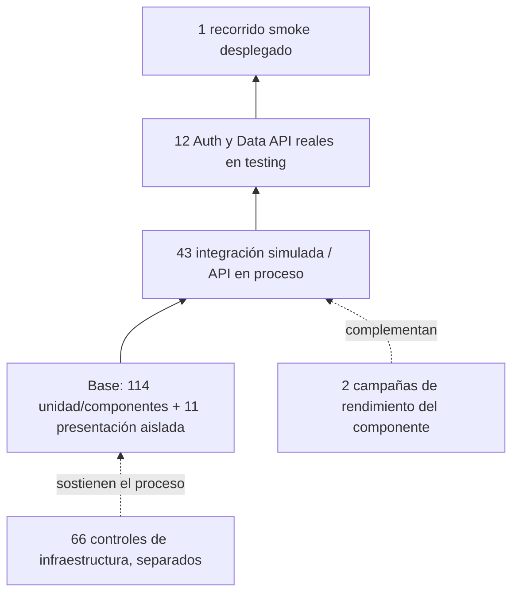

# Proceso, niveles y técnicas aplicadas — EQUITAS

Versión 1.0 — E09, 23/10/2026. Responsable: Axel Azcune. Requisitos R05/R06/R12/R13/R15/R22. [Plan](PLAN_PRUEBAS_CALIDAD.md), [catálogo](CASOS_PRUEBA_CALIDAD.md) y [trazabilidad](TRAZABILIDAD_CALIDAD.md).

## 1. QA y QC en el trabajo realizado

La distinción se basa en [ISTQB CTFL v4.0.1, §1.2.2](https://www.istqb.org/wp-content/uploads/2024/11/ISTQB_CTFL_Syllabus_v4.0.1.pdf): QA orienta la prevención y mejora del proceso; las pruebas y otros controles de QC evalúan resultados del producto. Una misma herramienta puede apoyar ambos según la actividad concreta.

| Práctica preventiva de QA | Control detectivo de QC y evidencia resultante |
| --- | --- |
| E00: alcance, responsables, criterios de entrada/salida y riesgos antes de avanzar. | Suites iniciales: 94 aprobadas, una externa omitida; diagnóstico de cobertura y hallazgos. [Base](evidencias/validacion-2026-10-21.json). |
| E01/E02: dependencias fijadas, instalación nueva y workflow versionado; no aceptar reportes de otra versión. | Build, lint y suites en Windows/Linux; CI publica reportes y conserva fallos. [E01](REGISTRO_EJECUCION_E01.md), [E02](REGISTRO_EJECUCION_E02.md). |
| E03: esperado de 3.507 filas y regresiones antes de corregir, mismo bloque de aserciones. | Cuatro fallos rojos reales, código corregido y verde con todas las filas. [Comparación](evidencias/e03/comparacion-dat-06.json). |
| E04: base fija, umbrales y clasificación explícita de críticos; política de excepción con vencimiento. | Gates sobre reportes actuales y ensayo crítico bloqueado; no se ocultan ramas, tokens ni audit completo. [Ficha](REGISTRO_EJECUCION_E04.md). |
| E05: fichas, plantillas y estados con alcance de cierre, responsables y enlace de evidencia. | Verificación de casos/tickets y regresiones; DEF-SUP-001 no se cierra por una prueba aislada ni por la corrección solo de testing. [Gestión](GESTION_CALIDAD.md). |
| E06/E07: datos sintéticos, separación del original, secretos fuera de reportes y verificación de SHA/URL/proyecto. | HTTP real A/B/none/inactive, smoke de navegador y rojo/verde del filtro. [E06](REGISTRO_EJECUCION_E06.md), [E07](REGISTRO_EJECUCION_E07.md). |
| E08: pesos de herramienta, dataset, SLO y parada publicados antes de ensayar. | PoC, dos cargas de pipeline, percentiles y recursos; primer CI bloqueado por imports. [Herramienta](HERRAMIENTA_INCORPORADA_CALIDAD.md), [cargas](REGISTRO_EJECUCION_E08.md). |
| E09: diccionario de indicadores y revisión cruzada antes de escribir el PDF. | Recálculo de denominadores, mapa de pruebas, contraste de metas y estados con artefactos verificados. [Métricas](METRICAS_CALIDAD.md), [evaluación ISO](MATRIZ_ISO25010_CALIDAD.md). |

GitHub Issues es el soporte real elegido en lugar de Jira: [12 tickets, 10 cerrados y 2 abiertos](evidencias/e09/seguimiento.json), asignados a `AxAzc`. Las plantillas de [caso](.github/ISSUE_TEMPLATE/caso_prueba.md) y [defecto](.github/ISSUE_TEMPLATE/defecto_calidad.md) conservan precondiciones, pasos, esperado/obtenido, versión, evidencia y alcance de cierre. No se infieren horas ni porcentaje de aporte a partir de commits; [aportes trazables](APORTES_TP_CALIDAD.md).

## 2. Mapa actual de niveles, sin doble conteo

Fuente: [inventario nominal](calidad/inventario-pruebas.json), JSON/JUnit de [CI main 39964341314](evidencias/e09/ci-summary.json), [smoke E07](evidencias/e07/smoke.json) y [cargas E08](evidencias/e08/resultados.json). Agrupación reproducida en [metricas.json](evidencias/e09/metricas.json). Cada variante parametrizada es un resultado del runner; un ID del catálogo puede agrupar varias variantes. Hay **56 IDs/familias**, no 56 nuevos tests.

| Nivel o grupo operativo disjunto | Cantidad aprobada | Archivos / ejecución | Límite |
| --- | ---: | --- | --- |
| Frontend unidad/componentes | **66** | `front/tests/unit/`: Auth 20, lector 20, paginación 5, riesgo/mora 6, mappers/selectores 3, recomendaciones 7, build-info 5. | Incluye servicios con dobles y handler; no todas son funciones puras. |
| Frontend presentación aislada | **11** | `front/tests/pages/`: páginas de datos 9 y estáticas 2. | Fachada de datos simulada; sin navegador autenticado. |
| Frontend integración simulada | **30** | `front/tests/integration/`: Auth 4, lectura completa 22, loader 4. | SDK/transporte controlados. No prueba las políticas cloud. |
| Backend unidad/componentes | **48** | `back/tests/test_*.py`, excluyendo `test_api_endpoints.py`. | Extract/transform/load/scoring/utilidades, con fixtures y dobles según caso. |
| Backend API en proceso | **5** | [TestClient FastAPI](back/tests/test_api_endpoints.py). | Contratos/rutas/validación con servicio controlado; no llamadas a Supabase cloud. |
| Backend integración ETL simulada | **8** | `back/tests/integration/`: pipeline 3, loader 5. | TSV temporales, idempotencia/reintentos con doble; no recarga de cartera municipal. |
| Integración externa real | **12** | [Suite HTTP Supabase](front/tests/external/supabase.integration.test.ts), job obligatorio de main. | Auth/Data API testing, JWT normal y lector/contexto productivos. No navegación E2E. |
| Sistema, smoke desplegado | **1 campaña** | [Recorrido E07](front/tests/smoke/deployed-smoke.mjs), cinco comprobaciones. | Un usuario A y ruta básica; no cinco campañas ni toda la aplicación. |
| No funcional: carga de componente por HTTP | **2 campañas** | [Escenarios k6](quality/load/scenarios.js), estrés y sostenido E08. | Tipo de prueba transversal sobre API representativa; no un nuevo nivel funcional de la web. |
| **Total acumulado de producto** | **183** | 168 aisladas + 12 externas + 1 smoke + 2 cargas. | Fuentes y versiones diferenciadas; cero fallidas/omitidas en el corte aceptado. |

**Infraestructura aparte: 66** controles en `quality/tests`, aprobados en el [log de CI](evidencias/e09/infrastructure-tests.log). Comprueban gates, procedencia, secretos/configuración, selección de preview, reportes y cargas. No se suman al producto para inflar el número ni se les atribuye cobertura funcional municipal.

La pirámide prioriza controles rápidos y específicos. La base agrupa **114** de unidad/componentes más **11** de presentación aislada; el siguiente grupo tiene **43** de integración simulada/API en proceso; luego **12** externas y **1** smoke. Las **2 cargas** complementan el mapa como pruebas no funcionales. Esta distribución describe lo implementado, sin fingir que todos los casos inferiores tienen igual costo o independencia.



No hay UAT municipal, matriz de navegadores ni integración web→FastAPI probada: ese consumo no existe en la arquitectura actual. La web consulta Supabase. Un `/health` correcto no sustituye un recorrido autenticado, y un snapshot SQL administrativo no sustituye Auth HTTP.

## 3. Ejemplo AAA real y ejecutado

Fuente [paginación, primer caso](front/tests/unit/pagination.test.ts), presente en las **5 variantes** aprobadas de ese archivo en [JUnit frontend](evidencias/e09/frontend-tests.xml). La separación Arrange–Act–Assert ya está en el test; los comentarios siguientes la explican sin agregar otra prueba.

```typescript
// Arrange: 25 valores conocidos; página y tamaño sin indicar.
const items = Array.from({ length: 25 }, (_, index) => index + 1)

// Act: ejecutar la función productiva una vez.
const result = paginateItems(items, undefined, undefined)

// Assert: valores concretos del contrato, no una copia del algoritmo.
expect(result.pageSize).toBe(10)
expect(result.currentPage).toBe(1)
expect(result.items).toEqual([1, 2, 3, 4, 5, 6, 7, 8, 9, 10])
expect(result.currentStart).toBe(1)
expect(result.currentEnd).toBe(10)
expect(result.totalPages).toBe(3)
```

El esperado es primera página, diez valores y tres páginas totales; el resultado coincide. Los otros casos ejercitan última parcial, entrada inválida, página fuera de rango y vacío. No se afirma que todo el desarrollo histórico haya seguido TDD: la secuencia previa comprobada corresponde específicamente a la regresión roja/verde E03 y a los criterios de E08.

## 4. Técnicas conectadas con E05

| Técnica | Particiones / límites realmente ejercitados | Casos y evidencia |
| --- | --- | --- |
| Equivalencias de lectura | Vacío, parcial, exacto, varias páginas, datos grandes; API/transporte fallido; respuesta inválida; cursor válido/inválido/repetido; bigint en texto. | DAT-01–14/FIXTURE-01, 42 variantes aisladas seleccionadas, [catálogo E05 ampliado](CASOS_PRUEBA_CALIDAD.md), [trazabilidad](TRAZABILIDAD_CALIDAD.md). |
| Límites de volumen y fin de página | N=0/7/1.000/1.001/2.000/3.507; máximo servidor 1.000/3.000/137. | DAT-06 conserva rojo/verde; no se confunde límite por respuesta con límite total de filas. |
| Equivalencias Auth | Sin configuración, sin sesión, error, usuario ausente, pertenencia activa/inactiva/ausente y contexto válido. | AUTH-01–09: 20 unitarias más 4 variantes de integración simulada existentes, sin sumarlas otra vez. E06 añade HTTP real con A/B/none/inactive. |
| Límites de riesgo | 0/39/40/69/70/100; NaN/−15/250. | [Riesgo/mora](front/tests/unit/risk-and-aging.test.ts): BAJO hasta 39, MEDIO 40–69, ALTO desde 70; normalización comprobada. |
| Decisión y límites de recomendación | Riesgo/contacto, mora 59/60 días, saldo 349.999/350.000 y deuda cero. | REC-01, **7/7** variantes: tabla siguiente y [ticket #7](https://github.com/ImaDecara/Tesis-EQUITAS/issues/7). |
| Límites de gate | 59,99/60 % existente, 79,99/80 % nuevo, 5/5,01 % duplicación y 5,0001 % sin ocultar por redondeo. | GATE-01–03; controles de infraestructura, [E04](REGISTRO_EJECUCION_E04.md). |

Tabla de decisión ejecutada REC-01. Fuente [test parametrizado](front/tests/unit/recommendation-decisions.test.ts), E04 `c95a9ab…` y revalidada en CI actual. Se comprueban `type`, `summary`, `isUrgent` y motivo no vacío; no se calcula el esperado llamando a la misma función.

| Regla | Riesgo | Contacto | Vencida | Total | Días | Salida esperada = obtenida | Urgente |
| --- | --- | --- | ---: | ---: | ---: | --- | --- |
| D1 | ALTO | Sí | 1 | 400.000 | 90 | Llamado prioritario | Sí |
| D2 | ALTO | No | 0 | 0 | 0 | Plan de pago / revisión humana | Sí |
| D3 | MEDIO | Sí | 1 | 1 | 60 | Plan de pago / revisión humana | Sí |
| D4 | MEDIO | Sí | 1 | 1 | 59 | Mensaje recordatorio | No |
| D5 | BAJO | Sí | 0 | 350.000 | 60 | Mensaje recordatorio | No |
| D6 | BAJO | No | 0 | 349.999 | 90 | Seguimiento posterior | No |
| D7 | BAJO | Sí | 0 | 0 | 0 | Seguimiento posterior | No |

D1 comprueba precedencia de riesgo alto aun con mora prolongada; D3/D4 cambia solo el límite de días. D5/D6 ejercitan ambos lados del límite de saldo pero también cambian otros campos: no se presentan como experimento de una sola variable. Estas siete reglas son los casos seleccionados, no una tabla exhaustiva de todas las combinaciones. El [catálogo](CASOS_PRUEBA_CALIDAD.md) conserva además las decisiones Auth aisladas y las identidades verificadas en la base real.

Sentencias y ramas se reportan con sus denominadores en [métricas](METRICAS_CALIDAD.md). La cobertura de ramas aporta evidencia de decisiones instrumentadas; no garantiza todas las combinaciones ni MC/DC. Aprobar siete reglas no equivale a 100 % de ramas de todo el frontend.

## 5. Siete principios aplicados

Referencia conceptual: [ISTQB CTFL v4.0.1, §1.3](https://www.istqb.org/wp-content/uploads/2024/11/ISTQB_CTFL_Syllabus_v4.0.1.pdf). La aplicación siguiente se basa en resultados propios, sin afirmar una distribución estadística de defectos que no se midió.

| Principio | Aplicación y decisión en EQUITAS | Evidencia |
| --- | --- | --- |
| Presencia de defectos | Cuatro DAT-06 rojos mostraron truncamiento; pasar el verde confirma esa corrección en el alcance probado, sin probar ausencia de otros defectos. | [Comparación E03](evidencias/e03/comparacion-dat-06.json), [defecto #2](https://github.com/ImaDecara/Tesis-EQUITAS/issues/2). |
| Exhaustividad imposible | Se seleccionan particiones, límites, dos tenants y tres operaciones de carga. No se recorren todos los volúmenes, roles, fechas y fallos de red posibles. | DAT/AUTH/REC del catálogo; [política E08](quality/load/policy.json). |
| Prueba temprana | Se publicaron esperado y aserciones E03 antes del arreglo; E08 fijó dataset/SLO/paradas antes de ejecutar, commit `09f040b…`. No se atribuye esa secuencia a todo el trabajo previo. | [Aceptación E03](CASOS_E03_LECTURA_COMPLETA.md), [plan E08](PLAN_RENDIMIENTO_E08.md). |
| Agrupamiento de defectos | Se concentra esfuerzo en lectura, autorización y ETL por impacto y complejidad observada. Los pocos defectos registrados no permiten afirmar una regla 80/20 demostrada. | [Riesgos](PLAN_PRUEBAS_CALIDAD.md#8-riesgos-priorizados), defectos DAT/SUP/UI, complejidad E01. |
| Renovación de casos | Se añadieron >3.000 filas, errores intermedios y dos tenants; el smoke corrigió un selector que no verificaba realmente Personas y agregó el input de Limpiar. Se conservan los ensayos previos como diagnóstico y las regresiones útiles. | [E07](REGISTRO_EJECUCION_E07.md), [diagnóstico del selector](evidencias/e07/diagnostico-selector/ALCANCE.md), [rojo/verde del filtro](evidencias/e07/filtro-rojo-verde.json). |
| Dependencia del contexto | MVP municipal con información sensible: aislamiento tenant y completitud primero; carga aislada por componente y despliegue Preview con datos sintéticos. No se extrapola a producción. | [ISO/top 3](MATRIZ_ISO25010_CALIDAD.md), [integración real](SUPABASE_TESTING_CALIDAD.md), [alcance de carga](RENDIMIENTO_CALIDAD.md). |
| Falacia de ausencia de errores | 183 resultados aprobados no demuestran utilidad municipal, seguridad del original ni accesibilidad completa. Se conservan metas parciales y tickets abiertos. | [Evaluación ISO](MATRIZ_ISO25010_CALIDAD.md), [seguimiento actual](evidencias/e09/seguimiento.json). |

## 6. Herramientas: propósito y resultado concreto

| Herramienta | Uso dentro del proceso y evidencia |
| --- | --- |
| Vitest/V8 4.1.12 | Unidad, componentes, presentación e integración simulada; suite externa por HTTP y cobertura frontend. JSON/JUnit/HTML de CI. |
| pytest 8.4.2 / coverage.py 7.16.2 | Backend/ETL/scoring/API en proceso, fixtures y cobertura de sentencias/ramas. Versión exacta fijada en dependencias Python. |
| ESLint 9.39.5 / Ruff 0.17.1 | Análisis estático con clasificación y excepciones documentadas; fallos propagan a CI. |
| jscpd 5.4.2 | Duplicación por líneas/tokens y complejidad orientativa; el gate usa líneas. |
| npm audit / política versionada | Auditoría completa y productiva, tratamiento separado de OBS-DEP-001 y vencimiento; sin ocultar salida cruda 1. |
| GitHub Actions / Git / GitHub Issues | Configuración de workflows, snapshots, procedencia, casos/defectos, commits y regresión. Jira no se utilizó. |
| Supabase Auth/Data API/Postgres | Dependencia externa real de testing con tenants conocidos y RLS; evidencia HTTP separada del análisis SQL administrativo. |
| Vercel / Playwright | Preview identificado y recorrido de navegador posterior al despliegue, con protección conservada y secretos fuera de artefactos. |
| **k6 2.3.0** | Herramienta nueva: PoC ejecutada, política previa, estrés/sostenido, series y HTML autónomo; [cinco pasos y matriz](HERRAMIENTA_INCORPORADA_CALIDAD.md). |
| Scripts `quality/` | Orquestación, validación de artefactos, procedencia y cálculo de gates/reportes; 66 contratos comprobados, aparte del producto. |

k6 fue elegido con pesos **20/20/20/20/10/10**, versionados antes de puntuar; resultados **4,70/5** k6, **4,30/5** Locust y **3,70/5** JMeter. La PoC ejecutada es solo k6; las otras puntuaciones son juicio documental, no benchmark comparativo. Su adopción CI terminó en E08. Esta etapa no agrega herramientas ni pruebas por cantidad.

## 7. Mantenimiento y entrega

Ante un cambio funcional, elegir nivel/técnica por riesgo; definir esperado antes de corregir; conservar rojo cuando exista, correr verde y regresión; actualizar caso/ticket y su evidencia. No cerrar DEF-SUP-001 original por evidencia exclusiva de testing. Cuando cambien denominadores o versiones, agregar un corte nuevo en métricas.

E10 integrará este contenido en el informe académico con metas cumplidas/parciales/no cumplidas y conclusiones; E11 verificará la demostración final. Los comandos y entornos operativos están en el [plan](PLAN_PRUEBAS_CALIDAD.md), [reproducción](REPRODUCIBILIDAD_CALIDAD.md), [Supabase testing](SUPABASE_TESTING_CALIDAD.md), [Vercel E07](CONFIGURACION_VERCEL_E07.md) y [cargas](RENDIMIENTO_CALIDAD.md).
