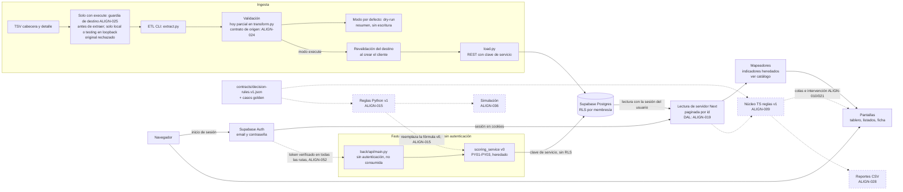

# ADR-001: Dónde viven las reglas de decisión y qué hace cada capa

| Campo | Valor |
|---|---|
| Ticket | ALIGN-013, plan `2026-10-28-v2` (M1) |
| Estado | **Aceptada (provisional)**: pendiente de la revisión independiente de otro proveedor exigida por el ticket |
| Fecha | 29/10/2026 |
| Decisiones del plan | D-01 (conservar Next.js, Supabase y ETL Python), D-03 (reglas en JSON versionado, núcleo TS y paridad Python; vista SQL como evolución), D-23 (FastAPI interna autenticada para la importación, la amplía ALIGN-052) |
| Código descrito | `c17a1bf83bc71fc63dc720d6b2d2be90d5e65b4f` (las citas `archivo:línea` refieren a ese commit) |
| Documentos relacionados | [Contrato de dominio v1](contrato-dominio-v1.md) (ALIGN-007), [reglas de decisión v1](reglas-decision-v1.md) y [`decision-rules.v1.json`](../../contracts/decision-rules.v1.json) (ALIGN-008), [catálogo de indicadores](catalogo-indicadores-v1.md), [ejecución segura del ETL](../../back/ETL/README.md) (ALIGN-025) |
| Exclusión | No reescribe la arquitectura ni mueve código: registra la decisión y las obligaciones que asumen otros tickets |

## 1. Contexto: la arquitectura real

La tesis describe EQUITAS como un sistema de apoyo a la decisión que combina diálogo, datos y modelos `[P0211]`. El código en `c17a1bf` tiene estas capas:

| Capa | Qué hay hoy | Evidencia |
|---|---|---|
| Ingesta | ETL por línea de comandos: lee los TSV de cabecera y detalle, transforma, calcula perfiles y carga por la API REST de Supabase con la clave de servicio. Por defecto solo revisa el lote (sin credenciales); `--execute` exige un destino local o de testing en loopback y rechaza siempre el proyecto original | `back/ETL/run_etl.py`, `back/ETL/extract.py`, `back/ETL/transform.py`, `back/ETL/load.py`, `back/ETL/config.py:50-107`, [README del ETL](../../back/ETL/README.md) |
| Validación | **Parcial**: el ETL omite filas sin clave numérica y convierte importes o fechas ilegibles en 0 o nulo. No hay validador del contrato de origen | `back/ETL/run_etl.py:175-185`, `311-323`, `back/ETL/transform.py:142-177`; contrato §10; ALIGN-024 |
| Base | Supabase (Postgres) con RLS por membresía activa; la Data API devuelve como máximo 1000 filas por consulta | `supabase/migrations/20261021220156_equitas_testing_schema.sql`, `supabase/migrations/20261021221030_active_membership_rls.sql`, `supabase/config.toml:9` |
| Autenticación | Supabase Auth con email y contraseña desde el navegador; la sesión viaja en cookies y los Server Components leen con la clave publicable más la sesión del usuario, de modo que RLS se aplica | `front/lib/services/auth-service.ts:170-205`, `front/lib/supabase-server.ts`, `front/components/auth/auth-guard.tsx` |
| Lectura y cálculo web | Next.js (App Router): un cargador de servidor lee las tablas paginando por `id` y los mapeadores calculan en cada consulta los indicadores heredados (riesgo, recomendación, puntaje 0–172) | `front/lib/data/raw-debtor-loader.ts`, `front/lib/data/paginated-table-reader.ts:46`, `front/lib/mappers/*`, [catálogo](catalogo-indicadores-v1.md) |
| Pantallas y reportes | Tablero, listados, ficha y vistas analíticas, solo lectura. No hay exportación de reportes desde la web | `front/app/**/page.tsx`; ALIGN-028 agrega los CSV |
| Reglas | **Tres fórmulas incompatibles**: índice heredado del ETL (persistido), puntaje y recomendación del frontend (por consulta) y puntaje y grupos del servicio Python. Las reglas v1 están integradas como especificación, pero ningún código las consume todavía | Contrato PR08, FO10–FO14, PY01–PY03 y §10; `contracts/decision-rules.v1.json`; ALIGN-009 y ALIGN-015 pendientes |
| FastAPI | Cuatro rutas GET (`/health`, `/case-groups/definitions`, `/case-groups/summary`, `/case-groups`) **sin autenticación**, con CORS para `localhost:3000` con credenciales y todos los métodos. El servicio de scoring usa el cliente con **clave de servicio** (ignora RLS y no filtra por municipio) y lee los perfiles sin paginar. **Ningún archivo de `front/` la llama** | `back/api/main.py:12-65`, `back/services/scoring_service.py:4`, `287-345` |

El problema que resuelve este ADR: una misma cartera recibe tres prioridades distintas, la falta de contacto suma severidad en unas y resta en otra (contrato §10), y la tesis podría describir una API que la aplicación no usa.

## 2. Decisión requerida

1. **Dónde se evalúan las reglas v1** (severidad, banderas, vulnerabilidad, intervención, prioridad y explicación) para que pantallas, reportes, servicio Python y simulación produzcan el mismo resultado con los mismos datos, corte y versión.
2. **Qué papel tiene FastAPI** y en qué condiciones puede desplegarse.
3. **Qué pasa con el scoring operativo Python** existente.

Restricciones: no reescribir la arquitectura (D-01); no modificar el proyecto original sin aprobación (plan v2 §7.6); los casos golden de ALIGN-008 son el oráculo; `as_of` sigue `NO_INTEGRADO`; las explicaciones deben ser fieles a la regla aplicada `[P0221]` y cada recomendación debe poder reconstruirse con sus datos y criterios `[P0113]`.

## 3. Opciones consideradas

### 3.1 Opción A: reglas en TypeScript leídas de un JSON compartido (elegida)

Un núcleo de funciones puras en TypeScript (ALIGN-009) lee `contracts/decision-rules.v1.json` y se evalúa en el servidor de Next sobre datos leídos con la sesión del usuario. Python implementa las mismas reglas desde el mismo JSON (ALIGN-015). Ambas implementaciones deben reproducir los 43 casos golden, los 14 pares contrafactuales y los 5 ordenamientos.

- **A favor:** no exige migrar ninguna base; los umbrales viven en un único archivo versionado; las funciones puras se prueban sin red ni base; la evaluación ocurre donde ya se leen los datos con RLS; revertir es revertir commits.
- **En contra:** dos implementaciones pueden divergir; la evaluación se repite en cada consulta; un consumidor que lea la base directamente (Data API, SQL) no obtiene la prioridad v1.
- **Mitigación:** los mismos golden en las dos suites (criterio de ALIGN-015: "golden idénticos en TS y Python"); cada resultado declara la versión de reglas y el corte; un cambio de parámetros crea una versión nueva con sus golden (reglas v1 §15).

### 3.2 Opción B: vista o función SQL (evolución)

Las reglas se implementan como vista o función de Postgres y cualquier cliente lee la prioridad ya calculada.

- **A favor:** un único lugar de cálculo para web, reportes, Python y lecturas directas; filtrar y ordenar por prioridad en la base.
- **En contra hoy:** para que valga en el proyecto real hay que **migrar el original**, lo que requiere aprobación humana y la remediación de ALIGN-045/046; el corte `as_of` todavía no existe como dato; las pruebas golden habría que repetirlas en SQL; la explicación contrastiva en SQL es frágil.
- **Condiciones para adoptarla:** migraciones del original autorizadas, `as_of` integrado por lote (ALIGN-024/032), reglas v1 aprobadas y estables, y los mismos golden pasando en la base. Se adopta con un ADR nuevo; las implementaciones TS y Python pasan a verificar contra la vista.

### 3.3 Opción C: FastAPI como fuente de reglas (descartada ahora)

La web consulta la prioridad a la API Python.

- **En contra:** la API no tiene autenticación y su servicio usa la clave de servicio (expondría la cartera de todos los municipios a quien llegue al puerto); hoy nadie la consume; agrega un servicio a desplegar y un salto de red en cada pantalla, contra D-01; la disponibilidad de la web pasaría a depender de un segundo proceso.
- **Qué la cambiaría:** la decisión de desplegar FastAPI con autenticación en todas sus rutas (D-03). Aun entonces, la web no la usaría para reglas mientras la opción A pase los golden.

### 3.4 Comparación

| Criterio | A: TS + JSON | B: vista/función SQL | C: FastAPI como fuente |
|---|---|---|---|
| Modifica el proyecto original | No | **Sí** (migración) | No |
| Respeta RLS en la lectura | Sí (sesión del usuario) | Sí, si la vista es `security_invoker` | **No** hoy (clave de servicio) |
| Autenticación necesaria nueva | No | No | **Sí** (ALIGN-052) |
| Paridad verificable con golden | Sí (TS y Python) | Sí, con pruebas en la base | Sí (Python) |
| Servicios a desplegar | Ninguno nuevo | Ninguno nuevo | Uno más |
| Disponible para lecturas directas por SQL | No | Sí | No |
| Reversión | Revertir commits | Migración inversa | Revertir commits y despliegue |

## 4. Decisión

1. **Fuente única de parámetros:** `contracts/decision-rules.v1.json`. Ningún umbral, banda, regla o texto de explicación se escribe dentro del código de TypeScript ni de Python.
2. **Evaluación en TypeScript (opción A):** el núcleo de ALIGN-009 se ejecuta en el servidor de Next, sobre los datos que el DAL de servidor (ALIGN-019) lee con la sesión del usuario. Pantallas y colas (ALIGN-010/021) y reportes CSV (ALIGN-028) consumen ese resultado; ningún componente de cliente recalcula reglas.
3. **Paridad Python:** `back/services/decision_rules_v1.py` (ALIGN-015) lee el mismo JSON y pasa los mismos golden. Lo usan la simulación (ALIGN-036) y el servicio interno.
4. **Vista o función SQL:** evolución, con las condiciones de §3.2. No se implementa en este plan.
5. **FastAPI no es fuente de reglas para la web.** La web no la consume para mostrar prioridades.
6. **FastAPI es un servicio interno y no se despliega sin autenticación.** Hasta que ALIGN-052 esté integrado, solo puede ejecutarse en `localhost` contra la base local con datos sintéticos. Para ejecutarse fuera de esa máquina debe cumplir, todas a la vez:
   - verificación de token en **todas** las rutas (algoritmo, emisor, audiencia y expiración) y contexto de municipio y rol resuelto en el servidor (ALIGN-052);
   - ninguna lectura con la clave de servicio general: cliente por solicitud con el contexto del usuario o lecturas acotadas al municipio autorizado (ALIGN-052);
   - CORS cerrado y el navegador sin acceso directo: la web llama servidor a servidor desde un Route Handler (D-23);
   - escucha solo en `localhost` o red interna; un despliegue público es otro ticket (ALIGN-050) y requiere la campaña de seguridad de ALIGN-059.
   Con ALIGN-052, FastAPI pasa a ser también el **servicio interno de importación**; ese ticket amplía este ADR.
7. **Destino del scoring operativo Python: alinear a v1 y archivar la fórmula v0.** En ALIGN-015, las rutas `/case-groups*` dejan de calcular con `classify_risk_band`, `calculate_priority_score`, `build_case_tags` y `assign_case_group` (contrato PY01–PY03) y pasan a agrupar por **intervención v1** (la cola) y a ordenar por **prioridad v1** con `decision_rules_v1.py`, leyendo la cartera completa (paginación por `id`). La fórmula v0 no queda como alternativa activa: se retira del camino operativo y su descripción queda en el contrato (PY01–PY03) y en el historial de git.
   - **Por qué alinear y no archivar todo:** ALIGN-015 pide que "API y simulación usen la misma regla" y ALIGN-052 asegura las rutas de scoring con contexto de usuario; retirarlas dejaría a ese ticket sin objeto.
   - **Cuándo se archiva por completo:** si ALIGN-052 se difiere o si ALIGN-015 muestra que la alineación excede su alcance, las rutas `/case-groups*` se retiran y la agrupación operativa queda solo en las colas de la web (ALIGN-010/021). El cambio se registra como versión nueva de este ADR.
   - Mientras ninguna de las dos cosas ocurra, el scoring v0 es **heredado y no operativo**: ninguna pantalla, reporte ni simulación lo usa.

## 5. Flujo real y capas

Trazo continuo: existe en `c17a1bf` y sigue igual en la integración con ALIGN-011 (`ab4c5b3`), que no modificó los archivos citados en este ADR. Trazo discontinuo: lo agrega el ticket indicado. El diagrama del plan (§4) muestra además la importación web, la analítica experimental y el chat, que no cambian esta decisión.

| Capa | Responsabilidad | No hace |
|---|---|---|
| ETL y validación | Leer el lote, validar contra el contrato de origen, cargar en el destino permitido | Calcular la prioridad v1 ni escribir en el original |
| Supabase | Guardar los datos y aplicar RLS por membresía | Calcular reglas (hasta la evolución de §3.2) |
| Auth | Identificar al usuario y su sesión | Decidir permisos de negocio en el navegador |
| Servidor Next (DAL y núcleo TS) | Leer con la sesión, evaluar reglas v1 y armar pantallas y reportes | Leer con la clave de servicio ni recalcular reglas en el cliente |
| FastAPI interna | Scoring alineado a v1 e importación (ALIGN-052), solo servidor a servidor | Servir reglas a la web ni exponerse sin autenticación |
| Python por lotes | Simulación con las mismas reglas | Modificar prioridades de la web |

## 6. Consecuencias y obligaciones

| Ticket | Obligación que deriva de este ADR |
|---|---|
| ALIGN-009 | Núcleo TS puro que lee el JSON y pasa todos los golden |
| ALIGN-010, 021 | Pantallas y colas consumen el núcleo TS; muestran versión de reglas y corte (o su sustituto rotulado) |
| ALIGN-014 | Las cifras del tablero siguen el [catálogo](catalogo-indicadores-v1.md); los indicadores heredados que se reemplazan por dimensiones v1 se agregan como entradas nuevas |
| ALIGN-015 | Paridad Python con los mismos golden; scoring alineado a v1 (§4.7); lectura completa paginada; FastAPI documentada como interna |
| ALIGN-019, 028 | El DAL de servidor es el único camino de lectura para pantallas y reportes |
| ALIGN-052 | Autenticación en todas las rutas, sin clave de servicio general; amplía este ADR con la importación interna |
| ALIGN-050, 059 | Cualquier despliegue de FastAPI fuera de la máquina local pasa por ellos |

Consecuencias aceptadas:

- Mientras ALIGN-009 y ALIGN-010 no estén integrados, las pantallas siguen mostrando los indicadores heredados del [catálogo](catalogo-indicadores-v1.md) y la tesis debe describirlos como tales.
- Las lecturas directas por la Data API no obtienen la prioridad v1 ni quedan auditadas (D-34); forzar un camino único es evolución.
- La paridad depende de que los golden cubran los casos de borde; un caso nuevo se agrega a las dos suites a la vez.

## 7. Control de versiones

| Versión | Fecha | Cambio |
|---|---|---|
| 1 | 29/10/2026 | Versión inicial (ALIGN-013). Provisional hasta la revisión independiente. ALIGN-052 la amplía con la importación interna |
| 1 (corrección 1) | 29/10/2026 | Revisión independiente: el diagrama muestra la guardia de `--execute` antes de extraer (`back/ETL/run_etl.py:69-72`), el final del dry-run sin escritura (`:113-118`) y la revalidación del destino al crear el cliente |
| 1 (implementación Python) | 29/10/2026 | ALIGN-015 implementa §4.3 y §4.7 sin cambiar la decisión: núcleo JSON v1, paginación por id y retiro de la fórmula v0 del servicio. Detalle en §8 |

## 8. Implementación Python — ALIGN-015

El diagnóstico y el diagrama de §1/§5 conservan el estado histórico del SHA
citado. En ALIGN-015, `back/services/decision_rules_v1.py` consume el JSON v1 y
reproduce los objetos completos, pares y ordenamientos del golden compartido.
`scoring_service.py` agrupa por intervención y ordena dentro de cada cola por
prioridad v1. Retira las cuatro funciones v0 de §4.7; su descripción permanece
en el contrato PY01–PY03 y el código, en git (BASE `b5bc9ab7`).

La lectura usa cursor por `id` hasta página vacía en perfiles, objetos y las
tablas que alimentan la decisión. El universo son todos los objetos, incluidos
los que no tienen perfil persistido. Las obligaciones y contactos originales,
no los agregados del perfil, alimentan el adaptador del contrato. Los errores
de lectura abortan la solicitud con HTTP 503, sin evaluar prefijos ni convertir
un fallo en un cero.

Las rutas de scoring requieren corte `as_of` declarado; responden con su
procedencia y la versión de reglas. El corte municipal sigue no integrado.
`severity_band` reemplaza el nombre v0 `risk_band`. No se modificó el frontend
ni se desplegó FastAPI: siguen vigentes todas las restricciones de §4.5/§4.6.
La paridad ejecutada aquí es Python contra el oráculo congelado; ejecutar la
suite TS corresponde a la integración de ALIGN-009.

El [README interno de la API](../../back/api/README.md) detalla contrato HTTP,
adaptación de faltantes, restricciones y reproducibilidad. Los resultados de
rendimiento E08/E11 no se extrapolan a esta versión: véase la nota en
[`RENDIMIENTO_CALIDAD.md`](../../RENDIMIENTO_CALIDAD.md).

## 8. Frontera de autorización de lecturas (ALIGN-019, 30/10/2026)

Las pantallas de servidor ya no dependen del `AuthGuard` de navegador para impedir
la lectura. `front/lib/server/dal.ts` usa `auth.getUser()` con el cliente de sesión,
resuelve el usuario de aplicación por `auth_user`, exige `user.status = ACTIVE`,
una membresía `tenant_user.status = true`, municipio activo y rol aprobado en el
catálogo `role.name`. No acepta roles enviados por el navegador ni equivalencias
implícitas (`admin`, `operator` o un ID de rol no conceden permisos).

Sin selección se exige exactamente una membresía activa. Con varias, se devuelve
`TENANT_SELECTION_REQUIRED`; el llamador puede indicar `tenantId` o la cookie
`equitas_tenant_id`. Esa selección es entrada no confiable: se vuelve a comprobar
contra las membresías del usuario en cada entrada, y nunca concede acceso sola.
El conteo exacto evita que un límite de filas oculte una segunda membresía.

`requireTenantAccess({ permission, tenantId? })` devuelve contexto y cliente de
sesión **solo dentro del servidor**. Lectura de cartera: `consulta`, `operador`,
`supervisor`; registro de decisiones: `operador`, `supervisor`; aprobación y
supervisión: `supervisor`; importación: `importador`, `supervisor`.
`importador_sistema` no tiene acceso web. Estos permisos no implementan escrituras.

`createTenantReader()` es la entrada de los cargadores de objetos y personas.
Cada consulta de negocio lleva el filtro del municipio autorizado, directamente o
por relaciones `!inner`, incluidas todas las páginas de una lectura paginada. Los
alias de relación se eliminan de las filas antes de mapearlas. Solo los catálogos
compartidos carecen de filtro de municipio; también requieren autorización previa.
RLS sigue siendo una segunda barrera, necesaria para las lecturas directas por la
Data API. La DAL no reemplaza RLS ni audita accesos directos a PostgREST.

Una denegación produce `DataAccessError`, sin cartera ni métricas. Los errores de
consulta conservan `DataWarning` y el tratamiento «no disponible» de ALIGN-011/012
(contrato §4.1.6); no se convierten en un cero ni en un vacío exitoso. No hay caché
de autorización entre solicitudes, clave de servicio ni secretos nuevos.

Puntos cubiertos: tablero `/`, objetos `/debtors`, detalle `/debtors/[debtorId]`,
personas `/people`, colas `/priority-cases`, sin contacto `/no-contact`, mora
`/debt-aging`, riesgo `/risk-analysis`, acciones recomendadas `/recommended-actions`.
Las futuras Server Actions (ALIGN-020), lecturas de revisión (021) y rutas CSV (028)
deben autorizar **dentro de cada entrada** y extender el lector con filtros de tenant
para tablas nuevas. La auditoría de apertura de detalle y exportación (069) debe
insertarse después de autorizar y antes de entregar el DTO, sin datos personales.

Validación actual: pruebas negativas y positivas con Auth/REST simulados, incluida
la separación por municipio con políticas permisivas simuladas. La prueba HTTP
HTML/RSC sobre Supabase local con `USING(true)` está pendiente de la liberación del
stack por ALIGN-018; este registro no afirma que se haya ejecutado.
