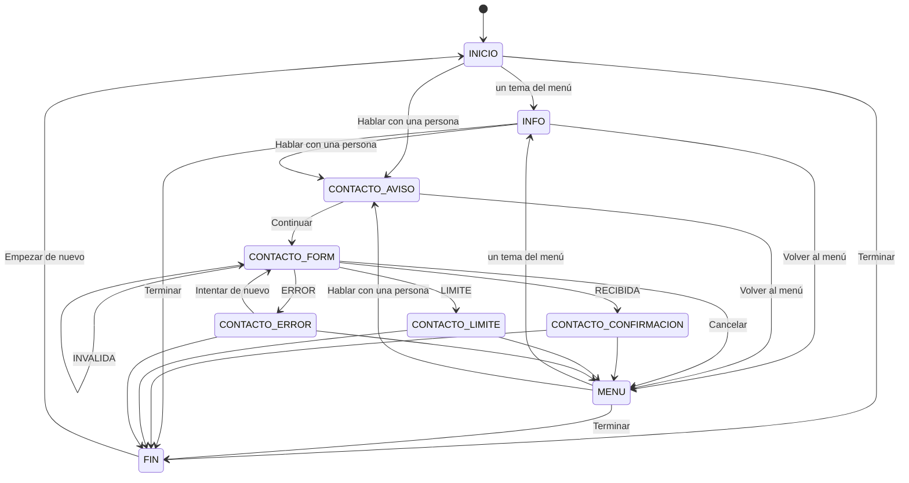

# Canal con el deudor: diseño, catálogo de textos y análisis de riesgo (v1)

> **Borrador — pendiente de aprobación (ALIGN-047, compuerta antes de cerrar)**. Ningún consumidor (ALIGN-065, 066, 071) puede publicar estos textos hasta que el usuario y el director aprueben este documento y el catálogo `contracts/channel-flow.v1.json`, y la aprobación quede registrada (§17).

| Campo | Valor |
|---|---|
| Ticket | ALIGN-047, plan `2026-10-28-v2` (M9, objetivo 6) |
| Versión | `1.0.0` del catálogo; estado `BORRADOR_PENDIENTE_APROBACION` |
| Contrato (fuente única) | `contracts/channel-flow.v1.json`: estados del flujo, textos con identificador, formulario, antiabuso, retención, derivación, acceso, accesibilidad y fases |
| Esquema | `contracts/channel-flow.v1.schema.json` (JSON Schema 2020-12, patrones ECMA-262 portables) |
| Prueba | `quality/tests/test_channel_flow.py`: valida el contrato contra el esquema y su coherencia (flujo sin callejones, textos usados y declarados, lenguaje, datos mínimos, retención, derivación) y que este documento reproduzca el catálogo palabra por palabra |
| Base | `bc0fd54` (integración de la noche 2: reglas v1, contrato de dominio, cartera sintética) |
| Decisiones que rigen | ALIGN-002 (chat web por reglas con derivación a operador, imprescindible; consulta de cuenta y WhatsApp, evolución), ALIGN-003 (escala 0–4, roles `operador` y `supervisor`), ALIGN-004 (ningún dato real) |
| Consumidores | ALIGN-065 (chat web y solicitud), ALIGN-066 (cola, devolución y registro), ALIGN-071 (verificación integrada); ALIGN-067 y 068 solo como condiciones de entrada (§2) |
| Datos personales | Ninguno. Los ejemplos son sintéticos: dominios reservados (`example.com`, `example.org`), teléfonos con ceros o con el código 555, que no es un código de área argentino, y vectores del alias de `gmail.com` con una parte local de dos letras, por debajo del mínimo de seis de ese proveedor |

## 1. Propósito y decisión que mejora

La tesis prevé un prototipo de canal con el deudor guiado por reglas, sin cobro ni decisiones autónomas `[T02.R07]`, como parte de interfaces simples y reemplazables (objetivo 6, `[P0194]`), con trato digno `[P0128]`. Implementarlo sin identificación robusta puede exponer deuda a terceros: con el padrón actual, un contacto registrado no prueba quién lo usa (contrato de dominio, AU05).

Este diseño fija **qué dice, qué guarda y qué nunca hace** el canal antes de escribir código, para **comunicar con trato digno y derivar a una persona** sin revelar información de cuentas. Es la especificación que implementan ALIGN-065 y ALIGN-066 y que verifica ALIGN-071.

## 2. Alcance y fases

| Fase | Qué incluye | Alcance | Tickets | Condición de entrada |
|---|---|---|---|---|
| 1 | Chat web por reglas, sin datos de cuenta; formulario mínimo para pedir que una persona contacte; devolución manual y registro | **Imprescindible** (este diseño) | 047, 065, 066, 071 | Este catálogo aprobado por el usuario y el director |
| 2 | Consulta del estado de cuenta tras identificación robusta | Evolución | 067 | Decisión de alcance; proveedor de identidad aprobado por el municipio (OIDC); procedimiento municipal de vínculo identidad ↔ persona; respuesta jurídica de ALIGN-042; prohibido usar como único factor un código enviado a contactos del padrón; versión 2.0.0 de este catálogo con su propia aprobación |
| 3 | WhatsApp Business | Evolución | 068 | Decisión, cuenta y proveedor; costos; plantillas aprobadas por el proveedor y por el usuario y el director; análisis de transferencia de datos al tercero; consentimiento previo verificable; sin información de cuenta salvo con la fase 2 |

Las fases 2 y 3 **no se diseñan aquí**: solo quedan sus condiciones de entrada (`fases` en el contrato). Exclusiones de esta fase: WhatsApp, modelos de lenguaje y acciones de cobro.

## 3. Principios

1. **No revelación.** El canal no lee la cartera: no hay consulta que pueda filtrar deuda ni confirmar existencia. La referencia que escribe la persona se guarda sin verificar y no cambia la respuesta.
2. **Minimización.** Solo se guardan datos si la persona pide contacto, y solo los seis campos del plan v2 §7.9; nada de identificación, situación del hogar ni texto libre (`[P0122]`, `[P0117]`, `[P0235]`).
3. **Una persona responde y decide.** El chat informa y deriva; la devolución es manual, fuera de EQUITAS, y ninguna intervención de cobranza pasa por este canal (`[T02.R07]`, ALIGN-003).
4. **Trato digno y lenguaje claro.** Textos fijos, aprobados, sin culpas, amenazas ni promesas, con alternativas humanas visibles `[P0128]`.
5. **Accesible por defecto.** WCAG 2.2 AA, móvil de 360 px, teclado y lector de pantalla (§13).
6. **Reemplazable.** El flujo vive en un JSON versionado; otro canal (fase 3) reutiliza el mismo catálogo con su propia aprobación.

## 4. Lo que el canal NO hace

Lista explícita (`el_canal_no_hace` en el contrato). Cada punto tiene una verificación en §14.

| Código | El canal no… |
|---|---|
| `NO_INFORMA_DEUDA` | No muestra deudas, importes, vencimientos, planes vigentes ni el estado de ninguna cuenta, con o sin referencia. |
| `NO_CONFIRMA_EXISTENCIA` | No confirma ni niega que una persona, un bien o una cuenta existan o tengan pagos pendientes: la respuesta es la misma para cualquier referencia. |
| `NO_CONSULTA_CARTERA` | No lee tablas de la cartera (objetos, obligaciones, personas, contactos, perfiles ni revisiones) ni valida la referencia contra la base. |
| `NO_PIDE_IDENTIFICACION` | No pide ni acepta DNI, CUIT, claves, datos de tarjetas o bancarios, fotos de documentos ni datos de salud o de la situación del hogar. |
| `NO_COBRA` | No recibe pagos, no genera boletas ni enlaces de pago y no calcula cuotas. |
| `NO_DECIDE` | No decide ni sugiere intervenciones sobre un caso, no registra decisiones de revisión y no modifica severidad, prioridad ni intensidad. |
| `NO_EJECUTA_INTERVENCIONES` | No ejecuta ningún nivel de la escala de intensidad 0–4 (ALIGN-003); en particular nunca una intimación (3) ni una derivación a procuración o vía judicial (4), ni por el chat ni por la devolución del operador. |
| `NO_ENVIA_MENSAJES` | No envía mensajes salientes (correo, SMS, WhatsApp ni notificaciones) ni códigos de verificación; la devolución la hace una persona, a mano y fuera de EQUITAS. |
| `NO_USA_LLM` | No usa modelos de lenguaje ni genera respuestas: solo muestra textos aprobados de este catálogo. |
| `NO_PROMETE` | No promete planes, descuentos, quitas, condonaciones, plazos de respuesta ni resultados de un trámite. |
| `NO_AMENAZA` | No menciona consecuencias del no pago (intimación, embargo, juicio) ni usa lenguaje culpabilizante, urgente o de último aviso. |
| `NO_INFIERE_VULNERABILIDAD` | No pregunta ni infiere la situación social o económica; los motivos de contacto no la revelan. |
| `NO_VINCULA_AUTOMATICAMENTE` | No vincula una solicitud con un caso: la vinculación es manual, posterior a una identificación por medio oficial y auditada (ALIGN-066, ALIGN-069). |
| `NO_RASTREA` | No registra la navegación por persona, no usa cookies de seguimiento, analítica ni huella del dispositivo, y no guarda la IP en claro. |
| `NO_SE_PRESENTA_COMO_PERSONA` | Se presenta como asistente automático con respuestas fijas; nunca simula ser una persona. |
| `NO_ASESORA_JURIDICAMENTE` | No da asesoramiento jurídico ni interpreta la situación de una deuda (exigibilidad, prescripción). |
| `NO_USA_TERCEROS` | No incrusta servicios de terceros (captcha externo, chat externo, analítica, mensajería) ni comparte datos con ellos. |
| `NO_ALIMENTA_REGLAS_NI_MODELOS` | Las solicitudes y su registro no se usan como variables de reglas, prioridad, simulación ni analítica experimental. |

En particular, el canal **nunca ejecuta intensidad 3 ni 4** (`intensidades_ejecutables` es una lista vacía) y la devolución del operador no es una intervención de la escala (regla `RO-05`).

## 5. Máquina de estados del flujo guiado

El chat es una conversación **de botones**: cada estado muestra textos del catálogo y opciones; no hay casilla de escritura libre fuera del formulario de contacto. La navegación ocurre en el navegador con el catálogo ya cargado: elegir una opción no envía datos al servidor ni deja registro. El único envío es el del formulario.

`INFO` agrupa los siete estados informativos de la tabla. Tabla completa, generada del contrato:

| Estado | Tipo | Textos que muestra | Opciones → destino |
|---|---|---|---|
| `INICIO` | MENU | `CAN-INICIO-BIENVENIDA-v1`, `CAN-INICIO-AUTOMATICO-v1`, `CAN-INICIO-SIN-DATOS-v1`, `CAN-INICIO-PREGUNTA-v1` | «Qué son las tasas municipales» → `INFO_GENERAL`; «Dónde y cómo pagar» → `INFO_PAGOS`; «Planes de pago» → `INFO_PLANES`; «Horarios y lugares de atención» → `INFO_ATENCION`; «Consultar el estado de una cuenta» → `INFO_ESTADO_CUENTA`; «Derechos y reclamos» → `INFO_DERECHOS`; «Cómo cuidamos tus datos» → `INFO_PRIVACIDAD`; «Hablar con una persona» → `CONTACTO_AVISO`; «Terminar» → `FIN` |
| `MENU` | MENU | `CAN-MENU-PREGUNTA-v1` | «Qué son las tasas municipales» → `INFO_GENERAL`; «Dónde y cómo pagar» → `INFO_PAGOS`; «Planes de pago» → `INFO_PLANES`; «Horarios y lugares de atención» → `INFO_ATENCION`; «Consultar el estado de una cuenta» → `INFO_ESTADO_CUENTA`; «Derechos y reclamos» → `INFO_DERECHOS`; «Cómo cuidamos tus datos» → `INFO_PRIVACIDAD`; «Hablar con una persona» → `CONTACTO_AVISO`; «Terminar» → `FIN` |
| `INFO_GENERAL` | INFO | `CAN-INFO-GENERAL-v1` | «Hablar con una persona» → `CONTACTO_AVISO`; «Volver al menú» → `MENU`; «Terminar» → `FIN` |
| `INFO_PAGOS` | INFO | `CAN-INFO-PAGOS-v1`, `CAN-AVISO-FRAUDE-v1` | «Hablar con una persona» → `CONTACTO_AVISO`; «Volver al menú» → `MENU`; «Terminar» → `FIN` |
| `INFO_PLANES` | INFO | `CAN-INFO-PLANES-v1` | «Hablar con una persona» → `CONTACTO_AVISO`; «Volver al menú» → `MENU`; «Terminar» → `FIN` |
| `INFO_ATENCION` | INFO | `CAN-INFO-ATENCION-v1` | «Hablar con una persona» → `CONTACTO_AVISO`; «Volver al menú» → `MENU`; «Terminar» → `FIN` |
| `INFO_ESTADO_CUENTA` | INFO | `CAN-INFO-ESTADO-CUENTA-v1`, `CAN-INFO-ESTADO-CUENTA-OFICIAL-v1` | «Hablar con una persona» → `CONTACTO_AVISO`; «Volver al menú» → `MENU`; «Terminar» → `FIN` |
| `INFO_DERECHOS` | INFO | `CAN-INFO-DERECHOS-v1`, `CAN-INFO-RECLAMOS-v1` | «Hablar con una persona» → `CONTACTO_AVISO`; «Volver al menú» → `MENU`; «Terminar» → `FIN` |
| `INFO_PRIVACIDAD` | INFO | `CAN-PRIVACIDAD-RESUMEN-v1`, `CAN-PRIVACIDAD-DETALLE-v1`, `CAN-PRIVACIDAD-RETENCION-v1`, `CAN-PRIVACIDAD-DERECHOS-v1`, `CAN-PRIVACIDAD-VINCULO-v1` | «Hablar con una persona» → `CONTACTO_AVISO`; «Volver al menú» → `MENU`; «Terminar» → `FIN` |
| `CONTACTO_AVISO` | AVISO | `CAN-CONTACTO-INTRO-v1`, `CAN-CONTACTO-QUE-NO-v1`, `CAN-PRIVACIDAD-DETALLE-v1`, `CAN-PRIVACIDAD-RETENCION-v1`, `CAN-PRIVACIDAD-VINCULO-v1` | «Continuar» → `CONTACTO_FORM`; «Volver al menú» → `MENU` |
| `CONTACTO_FORM` | FORMULARIO | `CAN-FORM-OBLIGATORIOS-v1` | «Enviar solicitud» → RECIBIDA: `CONTACTO_CONFIRMACION`, INVALIDA: `CONTACTO_FORM`, LIMITE: `CONTACTO_LIMITE`, ERROR: `CONTACTO_ERROR`; «Cancelar y volver al menú» → `MENU` |
| `CONTACTO_CONFIRMACION` | RESULTADO | `CAN-CONFIRMACION-v1`, `CAN-CONFIRMACION-TIEMPO-v1`, `CAN-AVISO-FRAUDE-v1`, `CAN-INFO-ATENCION-v1` | «Volver al menú» → `MENU`; «Terminar» → `FIN` |
| `CONTACTO_LIMITE` | RESULTADO | `CAN-LIMITE-v1`, `CAN-INFO-ATENCION-v1` | «Volver al menú» → `MENU`; «Terminar» → `FIN` |
| `CONTACTO_ERROR` | RESULTADO | `CAN-ERROR-ENVIO-v1`, `CAN-INFO-ATENCION-v1` | «Intentar de nuevo» → `CONTACTO_FORM`; «Volver al menú» → `MENU`; «Terminar» → `FIN` |
| `FIN` | FIN | `CAN-FIN-v1` | «Empezar de nuevo» → `INICIO` |

Propiedades verificadas por la prueba: todos los estados son alcanzables desde `INICIO`; desde cualquiera se llega a `FIN` y `FIN` permite empezar de nuevo (no hay callejones); todo menú y todo estado informativo ofrece «Hablar con una persona» en un paso; solo el formulario envía datos.

## 6. Catálogo de textos

Cada texto tiene un identificador estable `CAN-…-v1` (público) u `OPE-…-v1` (operador). Cambiar una palabra crea un identificador `-v2` y una versión nueva del catálogo, con nueva aprobación. Marcadores permitidos: datos públicos del municipio (`{nombre_organismo}`, `{telefono_oficial}`, `{direccion_oficial}`, `{horario_atencion}`, `{sitio_oficial}`, `{correo_oficial}`) y parámetros (`{dias_retencion}`, `{max_caracteres}`); solo en plantillas del operador, `{fecha_solicitud}`, `{motivo_etiqueta}` y `{respuesta_general}`. **Prohibidos** en cualquier texto: nombre, contacto, referencia, documento, importes, deuda, saldo, cuenta, vencimiento, domicilio, severidad, prioridad, intensidad y riesgo.

La columna «Validación previa» marca los textos que, además de la aprobación del usuario y el director, necesitan validación **jurídica** (privacidad, consentimiento, derechos) o del **municipio** (procedimientos y lugares de atención) antes de usarse con un municipio real. Para la demo con datos sintéticos alcanza con la aprobación de esta compuerta.

### 6.1 Textos del chat (público)

| ID | Tipo y uso | Texto | Validación previa |
|---|---|---|---|
| `CAN-INICIO-BIENVENIDA-v1` | Mensaje · `INICIO` | Hola. Este es el chat de información de {nombre_organismo} sobre tasas y contribuciones municipales. | — |
| `CAN-INICIO-AUTOMATICO-v1` | Mensaje · `INICIO` | Soy un asistente automático con respuestas fijas. No soy una persona y no tomo decisiones sobre tu situación. | — |
| `CAN-INICIO-SIN-DATOS-v1` | Mensaje · `INICIO` | Por tu seguridad, este chat no muestra información de cuentas ni de pagos pendientes. No escribas tu DNI, tu CUIT, claves ni datos de tarjetas. | — |
| `CAN-INICIO-PREGUNTA-v1` | Mensaje · `INICIO` | ¿Sobre qué tema querés información? | — |
| `CAN-MENU-PREGUNTA-v1` | Mensaje · `MENU` | ¿Sobre qué otro tema querés información? | — |
| `CAN-OPC-INFO-GENERAL-v1` | Opción · `INICIO`, `MENU` | Qué son las tasas municipales | — |
| `CAN-OPC-MEDIOS-PAGO-v1` | Opción · `INICIO`, `MENU` | Dónde y cómo pagar | — |
| `CAN-OPC-PLANES-v1` | Opción · `INICIO`, `MENU` | Planes de pago | — |
| `CAN-OPC-ATENCION-v1` | Opción · `INICIO`, `MENU` | Horarios y lugares de atención | — |
| `CAN-OPC-ESTADO-CUENTA-v1` | Opción · `INICIO`, `MENU` | Consultar el estado de una cuenta | — |
| `CAN-OPC-DERECHOS-v1` | Opción · `INICIO`, `MENU` | Derechos y reclamos | — |
| `CAN-OPC-PRIVACIDAD-v1` | Opción · `INICIO`, `MENU` | Cómo cuidamos tus datos | — |
| `CAN-OPC-PERSONA-v1` | Opción · `INICIO`, `MENU`, `INFO_GENERAL`, `INFO_PAGOS`, `INFO_PLANES`, `INFO_ATENCION`, `INFO_ESTADO_CUENTA`, `INFO_DERECHOS`, `INFO_PRIVACIDAD` | Hablar con una persona | — |
| `CAN-OPC-VOLVER-MENU-v1` | Opción · `INFO_GENERAL`, `INFO_PAGOS`, `INFO_PLANES`, `INFO_ATENCION`, `INFO_ESTADO_CUENTA`, `INFO_DERECHOS`, `INFO_PRIVACIDAD`, `CONTACTO_AVISO`, `CONTACTO_CONFIRMACION`, `CONTACTO_LIMITE`, `CONTACTO_ERROR` | Volver al menú | — |
| `CAN-OPC-TERMINAR-v1` | Opción · `INICIO`, `MENU`, `INFO_GENERAL`, `INFO_PAGOS`, `INFO_PLANES`, `INFO_ATENCION`, `INFO_ESTADO_CUENTA`, `INFO_DERECHOS`, `INFO_PRIVACIDAD`, `CONTACTO_CONFIRMACION`, `CONTACTO_LIMITE`, `CONTACTO_ERROR` | Terminar | — |
| `CAN-OPC-CONTINUAR-v1` | Opción · `CONTACTO_AVISO` | Continuar | — |
| `CAN-OPC-ENVIAR-v1` | Opción · `CONTACTO_FORM` (enviar) | Enviar solicitud | — |
| `CAN-OPC-CANCELAR-v1` | Opción · `CONTACTO_FORM` | Cancelar y volver al menú | — |
| `CAN-OPC-REINTENTAR-v1` | Opción · `CONTACTO_ERROR` | Intentar de nuevo | — |
| `CAN-OPC-EMPEZAR-v1` | Opción · `FIN` | Empezar de nuevo | — |
| `CAN-INFO-GENERAL-v1` | Mensaje · `INFO_GENERAL` | Las tasas y contribuciones municipales financian servicios y obras de {nombre_organismo}. Cada municipio fija sus tasas, sus valores y sus fechas de pago. La información oficial está en {sitio_oficial}. | Municipal |
| `CAN-INFO-PAGOS-v1` | Mensaje · `INFO_PAGOS` | Los medios de pago oficiales están informados en {sitio_oficial} y en {direccion_oficial}. Este chat no recibe pagos ni genera boletas. | Municipal |
| `CAN-AVISO-FRAUDE-v1` | Mensaje · `INFO_PAGOS`, `CONTACTO_CONFIRMACION` | Ni este chat ni la persona que responda tu consulta te van a pedir claves, datos de tarjetas ni pagos. Si alguien te los pide en nombre del municipio, no respondas y llamá al {telefono_oficial}. | — |
| `CAN-INFO-PLANES-v1` | Mensaje · `INFO_PLANES` | {nombre_organismo} define si ofrece planes de pago y con qué condiciones. Este chat no puede otorgar planes ni calcular cuotas. Si querés que una persona te explique las opciones, elegí «Hablar con una persona». | Municipal |
| `CAN-INFO-ATENCION-v1` | Mensaje · `INFO_ATENCION`, `CONTACTO_CONFIRMACION`, `CONTACTO_LIMITE`, `CONTACTO_ERROR` | Podés hacer consultas en persona en {direccion_oficial}, en el horario {horario_atencion}. También podés llamar al {telefono_oficial} o escribir a {correo_oficial}. | — |
| `CAN-INFO-ESTADO-CUENTA-v1` | Mensaje · `INFO_ESTADO_CUENTA` | Este chat no muestra el estado de ninguna cuenta y no confirma si una persona o un bien tiene pagos pendientes. Es así porque por este medio no podemos saber quién pregunta. | — |
| `CAN-INFO-ESTADO-CUENTA-OFICIAL-v1` | Mensaje · `INFO_ESTADO_CUENTA` | Para conocer tu situación, acercate a {direccion_oficial} con tu documento, en el horario {horario_atencion}. También podés pedir que una persona te contacte. | Municipal |
| `CAN-INFO-DERECHOS-v1` | Mensaje · `INFO_DERECHOS` | Tenés derecho a un trato respetuoso y a recibir información clara sobre tus obligaciones con el municipio. | Jurídica |
| `CAN-INFO-RECLAMOS-v1` | Mensaje · `INFO_DERECHOS` | Si no estás de acuerdo con un cobro o con la atención recibida, podés presentar un reclamo en {direccion_oficial} o por {correo_oficial}. También podés pedir que una persona te contacte. | Jurídica y municipal |
| `CAN-PRIVACIDAD-RESUMEN-v1` | Mensaje · `INFO_PRIVACIDAD` | Este chat no guarda lo que elegís en el menú. Solo guarda datos si pedís que una persona te contacte. | Jurídica |
| `CAN-PRIVACIDAD-DETALLE-v1` | Mensaje · `INFO_PRIVACIDAD`, `CONTACTO_AVISO` | En ese caso, {nombre_organismo} guarda los datos del formulario solo para responderte. Los ve únicamente el personal autorizado del área. No se comparten con otras organizaciones ni se usan para enviarte mensajes automáticos. | Jurídica |
| `CAN-PRIVACIDAD-RETENCION-v1` | Mensaje · `INFO_PRIVACIDAD`, `CONTACTO_AVISO` | Tu nombre, tu contacto y la referencia que escribas se borran a los {dias_retencion} días de la solicitud, aunque no se haya podido responder. | Jurídica |
| `CAN-PRIVACIDAD-VINCULO-v1` | Mensaje · `INFO_PRIVACIDAD`, `CONTACTO_AVISO` | Si te identificás por un medio oficial, una persona del área puede vincular tu consulta con tu caso. Ese vínculo queda en un registro de auditoría, con sus propias reglas de acceso y conservación. | Jurídica |
| `CAN-PRIVACIDAD-DERECHOS-v1` | Mensaje · `INFO_PRIVACIDAD` | Podés pedir ver, corregir o borrar tus datos antes de ese plazo en {direccion_oficial} o por {correo_oficial}. | Jurídica |
| `CAN-CONTACTO-INTRO-v1` | Mensaje · `CONTACTO_AVISO` | Dejanos un medio de contacto y una persona del área va a revisar tu pedido. Te va a responder por el medio que elijas. | — |
| `CAN-CONTACTO-QUE-NO-v1` | Mensaje · `CONTACTO_AVISO` | Por seguridad, la respuesta no va a incluir información de cuentas. Para eso hace falta que te identifiques por un medio oficial. | — |
| `CAN-FORM-OBLIGATORIOS-v1` | Ayuda · `CONTACTO_FORM` | Los campos sin la palabra «opcional» son obligatorios. | — |
| `CAN-CAMPO-NOMBRE-v1` | Etiqueta · campo `nombre` | Nombre (opcional) | — |
| `CAN-AYUDA-NOMBRE-v1` | Ayuda · campo `nombre` | Podés dejarlo vacío. Solo sirve para saber cómo llamarte cuando te respondan. | — |
| `CAN-CAMPO-MEDIO-v1` | Etiqueta · campo `medio_preferido` | ¿Cómo preferís que te respondan? | — |
| `CAN-MEDIO-TELEFONO-v1` | Medio · medio `TELEFONO` | Llamada telefónica | — |
| `CAN-MEDIO-EMAIL-v1` | Medio · medio `EMAIL` | Correo electrónico | — |
| `CAN-CAMPO-CONTACTO-v1` | Etiqueta · campo `contacto` | Teléfono o correo para responderte | — |
| `CAN-AYUDA-CONTACTO-v1` | Ayuda · campo `contacto` | Escribí el teléfono con código de área o tu correo electrónico, según lo que elegiste. No lo verificamos ni te enviamos códigos. | — |
| `CAN-CAMPO-MOTIVO-v1` | Etiqueta · campo `motivo` | Motivo de la consulta | — |
| `CAN-MOTIVO-INFO-GENERAL-v1` | Motivo · motivo `INFO_GENERAL` | Información general sobre tasas | — |
| `CAN-MOTIVO-MEDIOS-PAGO-v1` | Motivo · motivo `MEDIOS_PAGO` | Dónde y cómo pagar | — |
| `CAN-MOTIVO-PLANES-v1` | Motivo · motivo `PLAN_PAGOS` | Planes de pago | — |
| `CAN-MOTIVO-ESTADO-CUENTA-v1` | Motivo · motivo `ESTADO_CUENTA` | Estado de una cuenta | — |
| `CAN-MOTIVO-RECLAMO-v1` | Motivo · motivo `RECLAMO` | Reclamo o desacuerdo | — |
| `CAN-MOTIVO-DATOS-PERSONALES-v1` | Motivo · motivo `DATOS_PERSONALES` | Mis datos personales | — |
| `CAN-MOTIVO-OTRO-v1` | Motivo · motivo `OTRO` | Otro motivo | — |
| `CAN-CAMPO-REFERENCIA-v1` | Etiqueta · campo `referencia` | Número de cuenta o del bien (opcional) | — |
| `CAN-AYUDA-REFERENCIA-v1` | Ayuda · campo `referencia` | Puede ayudar a la persona que te responda. No lo revisamos ahora y no cambia lo que te muestra este chat. No escribas tu DNI ni tu CUIT. | — |
| `CAN-CAMPO-CONSENTIMIENTO-v1` | Etiqueta · campo `consentimiento` | Acepto que {nombre_organismo} guarde estos datos para responder mi consulta y los borre a los {dias_retencion} días. | Jurídica |
| `CAN-CAMPO-TRAMPA-v1` | Etiqueta · campo trampa `sitio_web` | No completes este campo | — |
| `CAN-ERROR-RESUMEN-v1` | Error · error `RESUMEN` | Hay datos para revisar. Te los marcamos debajo de cada campo. | — |
| `CAN-ERROR-OBLIGATORIO-v1` | Error · error `OBLIGATORIO` | Completá este campo. | — |
| `CAN-ERROR-LONGITUD-v1` | Error · error `LONGITUD_MAXIMA` | Este campo admite hasta {max_caracteres} caracteres. | — |
| `CAN-ERROR-OPCION-v1` | Error · error `OPCION_INVALIDA` | Elegí una de las opciones de la lista. | — |
| `CAN-ERROR-NOMBRE-v1` | Error · formato `NOMBRE` | Usá solo letras, espacios, puntos, apóstrofos o guiones. | — |
| `CAN-ERROR-TELEFONO-v1` | Error · formato `TELEFONO` | Escribí el teléfono con código de área, con entre 8 y 15 números. Podés usar espacios, guiones o paréntesis. | — |
| `CAN-ERROR-EMAIL-v1` | Error · formato `EMAIL` | Revisá el correo electrónico: tiene que tener una @ y un dominio, sin espacios. | — |
| `CAN-ERROR-REFERENCIA-v1` | Error · formato `REFERENCIA` | Usá solo letras sin tilde, números, espacios, guiones, barras o puntos. | — |
| `CAN-ERROR-CONSENTIMIENTO-v1` | Error · error `CONSENTIMIENTO_REQUERIDO` | Para enviar la solicitud tenés que aceptar el uso de tus datos. Si no querés, podés llamar al {telefono_oficial}. | — |
| `CAN-CONFIRMACION-v1` | Mensaje · `CONTACTO_CONFIRMACION` | Recibimos tu solicitud. Una persona del área la va a revisar y te va a responder por el medio que elegiste. | — |
| `CAN-CONFIRMACION-TIEMPO-v1` | Mensaje · `CONTACTO_CONFIRMACION` | El tiempo de respuesta depende de la cantidad de consultas. Si necesitás atención antes, llamá al {telefono_oficial}. | — |
| `CAN-LIMITE-v1` | Mensaje · `CONTACTO_LIMITE` | En este momento no podemos recibir más solicitudes. Probá de nuevo más tarde o llamá al {telefono_oficial}. | — |
| `CAN-ERROR-ENVIO-v1` | Mensaje · `CONTACTO_ERROR` | No pudimos confirmar el envío de tu solicitud. Probá de nuevo más tarde o llamá al {telefono_oficial}. | — |
| `CAN-FIN-v1` | Mensaje · `FIN` | Gracias por tu consulta. Si necesitás algo más, podés empezar de nuevo cuando quieras. | — |

### 6.2 Plantillas y guiones de la devolución (operador)

Los usa la persona operadora para preparar la devolución manual (ALIGN-066). `{respuesta_general}` es un espacio que completa a mano **solo con información general** (regla `RO-10`); su contenido no se guarda en EQUITAS.

| ID | Tipo y uso | Texto | Validación previa |
|---|---|---|---|
| `OPE-CORREO-ASUNTO-v1` | Plantilla · devolución | Respuesta a tu consulta en el chat de {nombre_organismo} | — |
| `OPE-CORREO-GENERAL-v1` | Plantilla · motivo `INFO_GENERAL`, motivo `MEDIOS_PAGO`, motivo `PLAN_PAGOS`, motivo `RECLAMO`, motivo `OTRO` | Hola. Te escribimos de {nombre_organismo} por la consulta que dejaste en el chat el {fecha_solicitud} sobre «{motivo_etiqueta}». {respuesta_general} Por seguridad, por correo no damos información de cuentas, porque no podemos confirmar quién recibe este mensaje. Para conocer tu situación, acercate a {direccion_oficial} con tu documento, en el horario {horario_atencion}. En este correo no te pedimos claves, datos de tarjetas ni pagos. Si no hiciste esta consulta, ignorá este mensaje y disculpá la molestia. | Municipal |
| `OPE-CORREO-ESTADO-CUENTA-v1` | Plantilla · motivo `ESTADO_CUENTA` | Hola. Te escribimos de {nombre_organismo} por la consulta que dejaste en el chat el {fecha_solicitud} sobre el estado de una cuenta. Por seguridad, no podemos darte esa información por correo, porque no podemos confirmar quién lo recibe. Podés consultarla en {direccion_oficial} con tu documento, en el horario {horario_atencion}. En este correo no te pedimos claves, datos de tarjetas ni pagos. Si no hiciste esta consulta, ignorá este mensaje y disculpá la molestia. | Municipal |
| `OPE-CORREO-DATOS-PERSONALES-v1` | Plantilla · motivo `DATOS_PERSONALES` | Hola. Te escribimos de {nombre_organismo} por la consulta que dejaste en el chat el {fecha_solicitud} sobre tus datos personales. Si querés que borremos los datos de tu solicitud, respondé este correo y los borramos. Para ver o corregir otros datos que tenga el municipio, acercate a {direccion_oficial} con tu documento, en el horario {horario_atencion}. En este correo no te pedimos claves, datos de tarjetas ni pagos. Si no hiciste esta consulta, ignorá este mensaje y disculpá la molestia. | Jurídica y municipal |
| `OPE-GUION-LLAMADA-v1` | Guion · devolución | Hola, te llamo de {nombre_organismo} por una consulta que se dejó en el chat de información el {fecha_solicitud}. ¿Hablo con la persona que hizo esa consulta? | — |
| `OPE-GUION-NO-ES-v1` | Guion · devolución | Disculpá la molestia, seguramente hubo un error con el número. Que tengas un buen día. | — |
| `OPE-GUION-SEGURIDAD-v1` | Guion · devolución | Por seguridad, por teléfono no podemos darte información de cuentas. Podés consultarla en {direccion_oficial} con tu documento, en el horario {horario_atencion}. | Municipal |
| `OPE-GUION-FRAUDE-v1` | Guion · devolución | En esta llamada no te vamos a pedir claves, datos de tarjetas ni pagos. | — |

## 7. Solicitud de contacto: datos mínimos y consentimiento

### 7.1 Campos

| Campo | Control | Obligatorio | Personal | Validación (tras normalizar) | Para qué se pide |
|---|---|---|---|---|---|
| `nombre` | Texto, `autocomplete=name` | No | Sí | `NOMBRE`: 1–80 letras Unicode, espacio, punto, apóstrofo o guion | Saber cómo dirigirse a la persona al responder |
| `medio_preferido` | Opción única (grupo con leyenda) | Sí | No | `TELEFONO` o `EMAIL` | Responder por el medio elegido |
| `contacto` | Texto, `autocomplete=tel` o `email` según el medio | Sí | Sí | `TELEFONO`: hasta 25 caracteres, 8–15 dígitos, `+` solo al inicio · `EMAIL`: hasta 254 ASCII, una `@`, dominio con TLD de letras | Hacer la devolución manual. **No se verifica** ni se envían códigos |
| `motivo` | Lista cerrada | Sí | No | Uno de los siete motivos (§7.2) | Elegir plantilla y medir demanda agregada |
| `referencia` | Texto, `autocomplete=off` | No | Sí | `REFERENCIA`: 1–30 ASCII, letras sin tilde, dígitos, espacio, `-`, `/`, `.` | Orientar a la persona operadora **después** de una identificación oficial; **nunca** se consulta contra la base |
| `consentimiento` | Casilla, **sin marcar** al inicio | Sí | No | Debe estar marcada | Constancia de la versión del aviso aceptada |

Normalización común: Unicode NFC, recorte de espacios y espacios repetidos reducidos a uno; un carácter de control o de formato invalida el campo; todo se guarda y se muestra como **texto plano**. Esta forma normalizada es la que se guarda y ve la persona operadora. El contrato trae vectores válidos e inválidos por formato (`solicitud_contacto.formatos`), que la prueba contrasta con una implementación de referencia y que ALIGN-065 debe reutilizar en sus pruebas.

**Campos prohibidos** (no existen en el formulario): documento, DNI, CUIT, domicilio, fecha de nacimiento, mensaje o comentario libre, adjuntos, situación del hogar, ingresos e importes. El campo trampa `sitio_web` está oculto a personas y lectores de pantalla.

### 7.2 Motivos

| Código | Texto | Plantilla de correo |
|---|---|---|
| `INFO_GENERAL` | Información general sobre tasas | `OPE-CORREO-GENERAL-v1` |
| `MEDIOS_PAGO` | Dónde y cómo pagar | `OPE-CORREO-GENERAL-v1` |
| `PLAN_PAGOS` | Planes de pago | `OPE-CORREO-GENERAL-v1` |
| `ESTADO_CUENTA` | Estado de una cuenta | `OPE-CORREO-ESTADO-CUENTA-v1` |
| `RECLAMO` | Reclamo o desacuerdo | `OPE-CORREO-GENERAL-v1` |
| `DATOS_PERSONALES` | Mis datos personales | `OPE-CORREO-DATOS-PERSONALES-v1` |
| `OTRO` | Otro motivo | `OPE-CORREO-GENERAL-v1` |

Ningún motivo revela la situación económica o social de la persona (por ejemplo, no hay «tengo dificultades para pagar»): quien necesita un plan elige `PLAN_PAGOS` y lo conversa con una persona.

### 7.3 Datos que agrega el servidor y datos que no se guardan

Agrega: `id` (UUID aleatorio, seudónimo de la solicitud), `tenant` (resuelto desde la ruta, nunca del cuerpo), `origen=CHAT_WEB`, `estado=NUEVA`, `creada_at`, `version_flujo`, `consentimiento_texto_id`, `consentimiento_at`, `purga_programada_at = creada_at + dias_retencion` y `purgada_at`.

No se guarda: IP en claro, clave canónica del contacto en claro (§7.5), agente de usuario, cookies o identificadores de sesión, navegación por el menú, huella del dispositivo, ubicación ni el cuerpo de la solicitud en registros del servidor.

### 7.4 Consentimiento

La casilla `CAN-CAMPO-CONSENTIMIENTO-v1` no viene marcada; sin ella el envío es `INVALIDA` con `CAN-ERROR-CONSENTIMIENTO-v1`, que ofrece el teléfono oficial como alternativa. Antes del formulario, `CONTACTO_AVISO` muestra qué pasa con la solicitud, que la respuesta no incluirá información de cuentas, quién ve los datos, cuándo se borran y qué pasa si la consulta se vincula con un caso. El aviso completo (`INFO_PRIVACIDAD`) cubre responsable, finalidad, quién accede, conservación, no cesión ni envíos automáticos y cómo pedir ver, corregir o borrar los datos, según los principios de finalidad y minimización de la Ley 25.326 `[P0235]`; su redacción final requiere validación jurídica (ALIGN-042).

### 7.5 Clave canónica del contacto

La normalización común conserva espacios, guiones y paréntesis: es la presentación que ve la persona operadora, y no sirve para reconocer a un mismo destinatario. El límite por contacto y la deduplicación usan otra cosa: una **clave canónica por medio**, derivada del contacto ya validado (`solicitud_contacto.clave_canonica`). La clave nunca se muestra ni se guarda en claro: solo su HMAC, en contadores de 24 horas.

**Teléfono** (forma `+<prefijo de país><dígitos>`, Argentina por el ámbito del plan):

1. Quitar espacios, guiones y paréntesis; queda un + opcional y dígitos.
2. Con +: los dígitos ya llevan el prefijo de país. Con 00 seguido de un dígito distinto de 0: se quita el 00 y los dígitos llevan el prefijo. Sin ninguno de los dos, si empiezan con 54 y tienen al menos 12 dígitos, también lo llevan. En otro caso se antepone 54.
3. Si el prefijo no es 54, la clave es + y los dígitos.
4. Con prefijo 54, sobre los dígitos nacionales: quitar un 0 inicial (prefijo troncal) si hay más de 10; después, quitar un 9 inicial (marca de celular) si hay más de 10; después, si hay exactamente 12, quitar el primer 15 que empiece en la posición 2, 3 o 4 contando desde 0 (el 15 sigue al código de área, de 2 a 4 dígitos).
5. La clave es +54 y los dígitos nacionales resultantes.

**Correo** (forma `<parte local>@<dominio>` en minúsculas):

1. Pasar a minúsculas (el formato solo admite ASCII).
2. Reemplazar el dominio por su equivalente, si tiene.
3. Quitar de la parte local desde el primer + (etiqueta), salvo que el + esté al inicio.
4. En los dominios sin puntos, quitar los puntos de la parte local.

Vectores del contrato, que la prueba contrasta con una implementación de referencia y que ALIGN-065 debe reutilizar:

| Medio | Clave | Formas equivalentes |
|---|---|---|
| Teléfono | `+540000000000` | `+54 000 000-0000`, `+54(000)0000000`, `+54-000-000-0000`, `+54 000 000 0000`, `(000) 0000-0000` |
| Teléfono | `+545550000000` | `+54 555 000-0000`, `+54 9 555 000 0000`, `+54 0 555 000 0000`, `+54 555 15 000 0000`, `54 555 000 0000`, `0054 555 000 0000`, `555 000 0000`, `0555 000 0000`, `0555 15 000 0000`, `555 15 000 0000` |
| Teléfono | `+34555000000` | `+34 555 000 000`, `0034 555 000 000` |
| Correo | `persona@example.com` | `persona@example.com`, `PERSONA@EXAMPLE.COM`, `Persona+chat@Example.com`, `persona+otra@example.com` |
| Correo | `ab@gmail.com` | `a.b@gmail.com`, `ab@googlemail.com`, `A.B+chat@GMAIL.COM` |

Pares que **no** deben unirse:

| Medio | Contacto | Contacto |
|---|---|---|
| Teléfono | `+54 555 000 0000` | `+54 555 000 0001` |
| Teléfono | `+54 555 000 0000` | `+54 555 150 0000` |
| Teléfono | `+54 555 000 0000` | `+34 555 000 0000` |
| Teléfono | `+54 555 000 0000` | `5550 0000` |
| Correo | `persona@example.com` | `persona@example.org` |
| Correo | `persona@example.com` | `per.sona@example.com` |
| Correo | `+a@example.com` | `+b@example.com` |

Escenarios exigidos a ALIGN-065 y ALIGN-071 (`escenarios_equivalencia`):

| Escenario | Qué prueba | Resultados | Solicitudes creadas |
|---|---|---|---|
| `ESC-TEL-MISMO-MOTIVO` | Cuatro formas del mismo teléfono con el mismo motivo se deduplican. | RECIBIDA, RECIBIDA, RECIBIDA, RECIBIDA | 1 |
| `ESC-TEL-MOTIVOS-DISTINTOS` | Cuatro formas del mismo teléfono con motivos distintos comparten el límite de 3. | RECIBIDA, RECIBIDA, RECIBIDA, LIMITE | 3 |
| `ESC-CORREO-MOTIVOS-DISTINTOS` | Cuatro formas del mismo correo con motivos distintos comparten el límite de 3. | RECIBIDA, RECIBIDA, RECIBIDA, LIMITE | 3 |

**Limitaciones.** No se unifican un teléfono sin código de área con el mismo número con código, números extranjeros escritos sin `+` ni `00`, alias de otros proveedores de correo ni dominios que aceptan cualquier dirección. Esos casos quedan cubiertos solo por los límites por IP y por municipio y por el cierre `ABUSO`.

## 8. No revelación: respuesta idéntica

El servidor evalúa el envío en este orden (`orden_de_evaluacion`): tamaño (más de 4096 bytes → `ERROR`), campo trampa (con valor → `RECIBIDA` sin guardar), límites por IP y por municipio (→ `LIMITE`), formato (→ `INVALIDA` con `{campo, codigo}`), duplicado por clave canónica y motivo en 24 h (→ `RECIBIDA` sin crear otra ni contar para el límite por contacto), límite por contacto sobre la clave canónica (→ `LIMITE`) y guardado (→ `RECIBIDA` o `ERROR`). El límite por contacto va después del formato porque solo un contacto válido tiene clave canónica.

| Resultado | Cuerpo | Cuándo | Estado del chat |
|---|---|---|---|
| `RECIBIDA` | `{"resultado": "RECIBIDA"}` | Válida, duplicada en 24 h o con campo trampa | `CONTACTO_CONFIRMACION` |
| `INVALIDA` | `{"resultado": "INVALIDA", "errores": [{campo, codigo}]}` | Formato inválido | `CONTACTO_FORM` |
| `LIMITE` | `{"resultado": "LIMITE"}` | Algún límite superado | `CONTACTO_LIMITE` |
| `ERROR` | `{"resultado": "ERROR"}` | Cuerpo demasiado grande o falla del servidor | `CONTACTO_ERROR` |

Garantías (`garantias_no_revelacion`): no consulta tablas de la cartera; no valida la referencia contra la base; no devuelve los datos enviados ni un número de solicitud; misma respuesta para cualquier referencia; mismo cuerpo para una solicitud válida, duplicada o con campo trampa; los errores dependen solo del formato; el aviso de límite no dice qué límite se superó (si dijera «este contacto ya pidió», revelaría que alguien usó ese contacto). Queda una inferencia residual: quien reciba `LIMITE` en su primer envío desde una conexión nueva puede suponer que ese contacto ya se usó; no dice nada sobre deudas ni cuentas. Como no hay lectura de la cartera, el tiempo de respuesta tampoco depende de la referencia.

## 9. Derivación a una persona (ALIGN-066)

### 9.1 Cola y cierres

Estados de la cola: `NUEVA` → `EN_CURSO` (asignar) → `RESUELTA` o `DESCARTADA` (cerrar); `EN_CURSO` → `NUEVA` (liberar); `NUEVA` → `DESCARTADA`. Los estados cerrados no se reabren: si la persona vuelve, es una solicitud nueva. Todo cambio pasa por funciones de servidor; no hay `UPDATE` ni `DELETE` directos.

| Motivo de cierre | Estado | Efecto |
|---|---|---|
| `RESPONDIDA` | `RESUELTA` | — |
| `DERIVADA_A_ATENCION_OFICIAL` | `RESUELTA` | — |
| `SUPRESION_SOLICITADA` | `RESUELTA` | Purga inmediata de los campos personales |
| `SIN_RESPUESTA_TRAS_INTENTOS` | `RESUELTA` | Tras 3 intentos en días distintos |
| `CONTACTO_NO_CORRESPONDE` | `DESCARTADA` | Purga inmediata: el contacto es de alguien que no pidió nada |
| `CONTACTO_INVALIDO` | `DESCARTADA` | — |
| `DUPLICADA` | `DESCARTADA` | — |
| `ABUSO` | `DESCARTADA` | — |

### 9.2 Reglas para la persona operadora

| Código | Regla |
|---|---|
| `RO-01` | Responder a mano por el medio que eligió la persona, fuera de EQUITAS y sin envíos automáticos. |
| `RO-02` | No dar información de cuentas, importes ni vencimientos, ni confirmar que la persona o el bien tienen cuentas o pagos pendientes, aunque la persona lo pida. |
| `RO-03` | En una llamada, preguntar primero si quien atiende hizo la consulta (OPE-GUION-LLAMADA-v1). Si dice que no, usar OPE-GUION-NO-ES-v1, no dar detalles y cerrar con CONTACTO_NO_CORRESPONDE. |
| `RO-04` | No pedir DNI, CUIT, claves, datos de tarjetas, pagos ni datos sobre la situación del hogar. |
| `RO-05` | La devolución no es una intervención de cobranza: no anuncia ni ejecuta ningún nivel de la escala 0–4. Si corresponde gestionar un caso, se hace en la revisión del caso (ALIGN-021), después de identificar a la persona. |
| `RO-06` | Vincular la solicitud con un caso solo después de identificar a la persona por un medio oficial; la vinculación es manual y queda auditada (ALIGN-069). |
| `RO-07` | Registrar preparación, intento, respuesta y cierre como códigos, sin copiar nombre, contacto ni el contenido de la respuesta. |
| `RO-08` | Hacer como máximo 3 intentos de contacto, en días distintos; después, cerrar con SIN_RESPUESTA_TRAS_INTENTOS. |
| `RO-09` | Si la persona pide borrar sus datos, cerrar con SUPRESION_SOLICITADA (purga inmediata). |
| `RO-10` | Tratar a la persona con respeto, sin juicios sobre ella ni sobre su situación, y completar {respuesta_general} solo con información general. |

La regla central es `RO-02`: la persona que responde **tampoco** da información de cuentas, porque el contacto lo escribió alguien no identificado y puede pertenecer a otra persona. La única vía hacia información propia es la identificación por un medio oficial (presencial hoy; ALIGN-067 en el futuro). La vinculación manual con un caso (`RO-06`) habilita gestionar ese caso en la revisión (ALIGN-021), nunca responder datos de cuenta por el canal.

### 9.3 Roles y acceso

| Rol | Puede |
|---|---|
| `anon` | Solo ejecutar la función de servidor de envío. Sin SELECT, INSERT, UPDATE ni DELETE directos sobre ninguna tabla del canal. |
| `operador` | Ver la cola de su municipio con los campos personales hasta la purga; asignar, registrar eventos y cerrar mediante funciones de servidor. Sin UPDATE ni DELETE directos. |
| `supervisor` | Ver indicadores agregados y el registro seudónimo de su municipio, sin nombre, contacto ni referencia en claro (salvo que también tenga el rol operador). |
| `consulta` | Nada del canal. |
| `importador` | Nada del canal. |
| `importador_sistema` | Nada del canal. |
| `otro_municipio` | Nada: toda lectura y escritura se filtra por el municipio resuelto en el servidor. |
| `tarea_de_purga` | Suprimir campos personales vencidos o con cierre de purga inmediata y registrar el evento PURGA. |
| `reglas_analitica_simulacion` | Nada: los datos del canal no alimentan severidad, prioridad, intensidad, simulación ni analítica experimental. |

`operador` y `supervisor` son los roles de ALIGN-003. Que el supervisor no vea contactos en claro es una decisión de minimización (D8); si debe atender, necesita también el rol `operador`.

## 10. Registro de interacciones

- **Qué se registra** (append-only, ALIGN-066): eventos `ASIGNACION`, `LIBERACION`, `PREPARACION` (con el id de la plantilla), `INTENTO` (medio y resultado `CONTESTO`, `NO_CONTESTO`, `CONTACTO_INVALIDO` o `CONTACTO_NO_CORRESPONDE`), `RESPUESTA_REALIZADA`, `CIERRE` (motivo), `VINCULACION_CASO` y `PURGA`, cada uno con `solicitud_id`, `tenant`, actor, fecha y medio.
- **Qué no se registra:** nombre, contacto, referencia ni el contenido de la respuesta. El registro es **seudónimo, no anónimo**: usa `solicitud_id`, y si la solicitud se vinculó con un caso ese id sigue permitiendo llegar a la persona a quien acceda al vínculo y al caso (§11).
- **Indicadores:** solo `RESPUESTA_REALIZADA` cuenta como respuesta; guardar o preparar una plantilla no inicia ni cierra ningún indicador. Se rotulan «Eventos declarados por la persona operadora; no prueban que el mensaje haya sido entregado ni leído» (`[P0195]`).
- **Navegación del chat:** no se registra por persona ni por sesión (D13).
- **Registros del servidor:** sin cuerpos de solicitudes ni IP; errores con códigos.

## 11. Retención y purga

| Dato | Conservación | Cómo se elimina |
|---|---|---|
| `nombre`, `contacto`, `referencia` de la solicitud | **90 días** desde `creada_at` por defecto (configurable entre 30 y 90; nunca más sin una versión nueva), en cualquier estado | Tarea programada al menos diaria: pasan a nulo y se registra `purgada_at` y el evento `PURGA` |
| Mismos campos con cierre `SUPRESION_SOLICITADA` o `CONTACTO_NO_CORRESPONDE` | Hasta el cierre | Purga inmediata al cerrar |
| Resto de la solicitud (id, tenant, motivo, medio elegido, estados, fechas, versiones) | Indefinida, para indicadores agregados | — |
| Registro de interacciones | Indefinida; sin nombre, contacto ni referencia; seudónimo (§10) | — |
| Contadores antiabuso (HMAC de IP y de contacto) | 24 horas | Vencimiento por ventana |
| Vínculo `solicitud_id` ↔ caso (si una persona lo hizo tras identificar) | Dato seudónimo en la auditoría de ALIGN-069, con el acceso y la retención que declara ese ticket | La purga suprime los campos directos de la solicitud, pero no borra ese vínculo |

**Alcance de la purga:** elimina los campos directos (`nombre`, `contacto`, `referencia`); no convierte en anónimo lo que queda vinculado. Verificación exigida a ALIGN-065: con reloj simulado, a `creada_at + 90 días + 1 s` no queda ninguno de esos campos. Limitación: las copias de seguridad, si existieran, conservarían datos más tiempo; en la base local sintética de este plan no hay copias, y para un municipio real lo resuelve ALIGN-050.

## 12. Abuso y límites

| Control | Valor por defecto | Qué previene |
|---|---|---|
| Por IP (HMAC-SHA-256 con secreto de servidor) | 5 por hora y 20 por día | Bots e inundación de la cola |
| Por contacto (HMAC de la clave canónica, §7.5) | 3 solicitudes creadas por día | Acoso a un tercero cuyo teléfono o correo alguien escribe repetidamente, de una o de varias formas |
| Por municipio | 200 por día | Saturar a los operadores |
| Duplicado (misma clave canónica y motivo) | 24 horas | Solicitudes repetidas en la cola |
| Campo trampa | Respuesta `RECIBIDA` sin guardar | Bots simples sin darles señal |
| Tamaño y longitudes | Cuerpo ≤ 4096 bytes; campos según §7.1 | Abuso de almacenamiento e inyección |
| Texto plano | Sin HTML, sin caracteres de control | Inyección en la cola del operador |
| Captcha de terceros | **No** | Enviar datos a un tercero y excluir a personas con discapacidad |

Los envíos inválidos también cuentan para los límites por IP y por municipio (evita sondear formatos). El secreto del HMAC vive en el servidor por entorno, nunca en el navegador ni en el repositorio.

## 13. Accesibilidad y lenguaje claro

**Objetivo: WCAG 2.2 nivel AA.**

| Código | Requisito |
|---|---|
| `ANCHO_360` | Usable en 360 px de ancho y con zoom de 200 % sin desplazamiento horizontal. |
| `TECLADO` | Todo se opera con teclado, con foco visible y orden lógico; ningún foco queda oculto. |
| `LECTOR_PANTALLA` | Cada respuesta nueva se anuncia en una región aria-live polite y el foco pasa a su encabezado; las opciones son botones de una lista. |
| `ETIQUETAS_VISIBLES` | Cada campo tiene etiqueta visible asociada; opcionales indicados en la etiqueta; opciones de medio en un grupo con leyenda. |
| `ERRORES_TEXTUALES` | Errores en texto junto al campo, vinculados con aria-describedby, y un resumen al inicio que recibe el foco. |
| `CONTRASTE` | Contraste de texto de al menos 4,5:1 y de componentes de al menos 3:1. |
| `SIN_DEPENDER_COLOR` | Ningún estado o error se comunica solo con color. |
| `OBJETIVOS_24PX` | Botones y casillas de al menos 24 × 24 px. |
| `SIN_LIMITE_TIEMPO` | Sin límites de tiempo ni sesiones que expiren mientras se completa el formulario. |
| `IDIOMA_ES_AR` | Página con lang es-AR. |
| `MOVIMIENTO_REDUCIDO` | Sin animaciones obligatorias; respeta prefers-reduced-motion. |
| `SIN_CAPTCHA` | Sin desafíos visuales ni auditivos; el antiabuso es invisible para la persona. |
| `ALTERNATIVA_HUMANA` | Teléfono y atención presencial visibles en los avisos de límite, error y confirmación. |

**Lenguaje claro** (control automático **parcial** sobre cada texto): oraciones de hasta 25 palabras; largos máximos por tipo (opción y motivo ≤ 40 caracteres, mensaje ≤ 300); sin términos culpabilizantes, amenazantes o técnicos (moroso, deudor, incumplimiento, embargo, juicio, intimación, sanción, multa, último aviso, urgente, prescripción, puntaje, riesgo, probabilidad, vulnerabilidad, prioridad, saldo, importe, monto, «tu deuda»); sin promesas (garantizar, asegurar, descuentos, condonaciones, quitas, bonificaciones, «sin interés», plazos como «en 48 horas»); sin mayúsculas sostenidas salvo DNI y CUIT; sin afirmaciones sobre la situación de una persona o de un bien («tenés pagos», «no tenés pagos», «tenés que pagar», «estás al día», «encontramos»); sin importes literales (símbolo o nombre de moneda, números con decimales) y sin dígitos fuera de los mensajes de error; sin URL ni teléfonos literales (solo los marcadores del municipio). Estas listas detectan errores conocidos, pero **no demuestran la no revelación**: cada versión aprobada exige la **revisión semántica humana** de todos sus textos. Tratamiento: **voseo** (pregunta 1 de §17). La comprensión real con personas no técnicas no se evaluó (`[P0246]`): queda para la prueba formativa (ALIGN-038).

## 14. Análisis de riesgo

| ID | Riesgo | Escenario | Controles del diseño | Verificación | Residual |
|---|---|---|---|---|---|
| RC-01 | Exposición de deuda a terceros | Alguien pregunta por la cuenta de otra persona | El canal no lee la cartera (`NO_CONSULTA_CARTERA`); textos sin marcadores de cuenta ni afirmaciones sobre deudas | 065: ningún endpoint devuelve información de cuenta; prueba de este contrato (control parcial); revisión semántica humana de cada versión | Bajo |
| RC-02 | Oráculo de existencia | Probar referencias y comparar respuestas, errores o tiempos | Referencia no verificada; respuesta idéntica; errores solo de formato; sin lectura de la base | 065: misma respuesta para referencias existentes e inexistentes | Bajo |
| RC-03 | Exposición en la devolución | El contacto escrito pertenece a otra persona y el operador le habla de una deuda | `RO-02`, `RO-03`, guion `OPE-GUION-LLAMADA-v1`, plantillas sin datos de cuenta, cierre `CONTACTO_NO_CORRESPONDE` con purga | 066: E2E con destinatario sintético; capacitación del operador | Medio: depende de que la persona cumpla las reglas |
| RC-04 | Suplantación o fraude | Terceros imitan al municipio y piden pagos o claves | `CAN-AVISO-FRAUDE-v1`, `OPE-GUION-FRAUDE-v1`; sin enlaces de pago; el chat no pide claves | Prueba de lenguaje; revisión de textos | Medio (externo) |
| RC-05 | Acoso a un tercero | Alguien carga el teléfono de otra persona muchas veces, también escrito de formas distintas | Clave canónica por medio (§7.5) para el límite por contacto y los duplicados, primera pregunta del guion, cierre con purga, motivo `ABUSO` | 065 y 071: escenarios `ESC-TEL-MISMO-MOTIVO` y `ESC-TEL-MOTIVOS-DISTINTOS` | Bajo; las formas no unificables de §7.5 dependen de los otros límites |
| RC-06 | Inundación o denegación | Bots llenan la cola | Límites por IP y municipio, campo trampa, tamaño máximo | 065 y 071: abuso | Bajo |
| RC-07 | Recolección excesiva o sensible | La persona escribe DNI, salud o su situación económica | Sin texto libre; patrones cerrados; avisos «no escribas tu DNI»; motivos sin situación social | Prueba de este contrato (campos mínimos y prohibidos) | Bajo: la referencia podría contener un número sensible; se purga a los 90 días |
| RC-08 | Retención excesiva | Contactos guardados indefinidamente | Purga de los campos directos a 90 días en cualquier estado, purga inmediata en supresión, contadores de 24 h, registro sin campos directos | 065: reloj simulado; 071: purga verificada | Bajo (copias de seguridad: ALIGN-050). El registro y el vínculo con un caso siguen siendo seudónimos |
| RC-09 | Acceso indebido | `anon` lee la cola u operadores de otro municipio la ven | Función de servidor sin `INSERT`/`SELECT` directos; RLS por municipio y rol; supervisor sin contacto en claro | 065: Data API; 066: permisos | Bajo |
| RC-10 | Inyección en la cola | Un campo con HTML o caracteres de control se ejecuta al mostrarlo | Texto plano, normalización, patrones, longitudes | 065 y 066: escape al mostrar | Bajo |
| RC-11 | Promesas o información incorrecta | El chat promete un plan o informa un horario desactualizado | Catálogo aprobado; promesas prohibidas; configuración del municipio obligatoria y validada; marcas de validación municipal | Prueba de lenguaje; aprobación | Medio: los datos del municipio pueden quedar viejos |
| RC-12 | Trato indigno | Lenguaje culpabilizante o amenazante | Términos prohibidos; sin consecuencias del no pago; aprobación del director | Prueba de lenguaje | Bajo |
| RC-13 | Exclusión | Personas con lector de pantalla, móvil chico o baja alfabetización no pueden usarlo | WCAG 2.2 AA, 360 px, sin captcha, oraciones cortas, alternativas humanas visibles | 065: accesibilidad aprobada; 038: prueba formativa | Medio hasta probar con personas |
| RC-14 | Confusión de rol | La persona cree hablar con alguien o que el chat decide | `CAN-INICIO-AUTOMATICO-v1` al inicio | Revisión de textos | Bajo |
| RC-15 | Uso del canal para cobranza | El canal se usa para intimar o para marcar «contactables» que suben prioridad | `NO_EJECUTA_INTERVENCIONES`, `NO_ALIMENTA_REGLAS_NI_MODELOS`, `RO-05`; sin acceso de reglas ni analítica | Prueba de este contrato; 066: permisos | Bajo |
| RC-16 | Indicadores engañosos | Se presentan eventos declarados como entregas | Rótulo obligatorio; solo `RESPUESTA_REALIZADA` cuenta | 066: guardar una plantilla no inicia el indicador | Bajo |
| RC-17 | Tercero que procesa datos | Captcha, analítica o mensajería externa | `NO_USA_TERCEROS`; WhatsApp solo en fase 3 con análisis de transferencia | Revisión de 065 | Bajo |
| RC-18 | Vinculación errónea con un caso o reidentificación | Se asocia la solicitud a otra persona, o alguien con acceso al vínculo y al caso reidentifica a quien consultó después de la purga | Solo manual, tras identificación oficial, auditada (`RO-06`); `CAN-PRIVACIDAD-VINCULO-v1` lo informa; vínculo seudónimo con el acceso y la retención de ALIGN-069 | 066 y 069 | Medio (humano) |
| RC-19 | Datos personales en registros técnicos | El servidor guarda cuerpos o IP | `no_se_guarda`; IP solo como HMAC; errores con códigos | 065 y 071: revisión de registros | Bajo |
| RC-20 | Configuración del municipio falsa o incompleta | Un teléfono oficial equivocado deriva llamadas a un tercero | Configuración obligatoria con formato; sin ella la ruta no se publica | 065 | Medio: requiere control humano de los valores |

## 15. Obligaciones para los consumidores

| Ticket | Debe |
|---|---|
| ALIGN-065 | Leer el flujo y los textos de `contracts/channel-flow.v1.json` (sin textos propios) y negarse a publicar si `estado` no es `APROBADO`; navegación en el navegador sin registro; formulario con los seis campos, normalización y vectores de `formatos`; clave canónica de §7.5 con sus vectores `equivalencias` y `distintos`, separada del contacto que ve el operador; función de servidor de envío con el orden y las respuestas de §8; pruebas ejecutables de los escenarios `ESC-TEL-MISMO-MOTIVO`, `ESC-TEL-MOTIVOS-DISTINTOS` y `ESC-CORREO-MOTIVOS-DISTINTOS`; sin `INSERT`/`SELECT` directos para `anon`; límites y campo trampa de §12; purga programada con reloj simulado (§11); accesibilidad de §13 en 360 px; ruta oculta si falta la configuración del municipio |
| ALIGN-066 | Cola con los estados, transiciones y motivos de cierre de §9.1; purga inmediata para `SUPRESION_SOLICITADA` y `CONTACTO_NO_CORRESPONDE` (reutilizando la función de purga de 065); plantillas `OPE-*` del catálogo; mostrar el contacto normalizado, nunca la clave canónica; eventos de §10 sin nombre, contacto ni referencia; solo `RESPUESTA_REALIZADA` cuenta como respuesta; acceso de §9.3; vinculación manual auditada con ALIGN-069 |
| ALIGN-071 | Verificar sobre la integración: no revelación (§8), abuso (§12) incluidos los escenarios `ESC-TEL-MISMO-MOTIVO` y `ESC-TEL-MOTIVOS-DISTINTOS` contra el endpoint, permisos (§9.3), purga (§11), recorrido de derivación (§9) y que los textos publicados sean los de la versión aprobada |

## 16. Decisiones de interpretación (lectura más acotada)

| # | Ambigüedad | Decisión v1 |
|---|---|---|
| D1 | «Chat» guiado por reglas | Conversación de botones con textos fijos; sin casilla de escritura libre ni modelos de lenguaje |
| D2 | Contenido de la solicitud | Exactamente los seis campos del plan v2 §7.9; sin comentario libre; motivos cerrados y sin motivos que revelen la situación económica |
| D3 | «Medio de contacto preferido» | Llamada telefónica o correo electrónico. Responder por WhatsApp, aun a mano, queda fuera: involucra a un tercero y es la fase 3 |
| D4 | Confirmación | Sin número de solicitud: evita una consulta de estado (otra superficie) y una prueba de existencia |
| D5 | Desde cuándo corre la retención | Desde la creación, en cualquier estado, aunque la solicitud no se haya respondido; purga inmediata si la persona pide borrar o el contacto no corresponde |
| D6 | Aviso de límite | Genérico: no dice si el límite fue por IP, contacto o municipio |
| D7 | Campo trampa | Responde igual que una solicitud válida y no guarda nada |
| D8 | Supervisor | Ve indicadores y registro seudónimo, sin contactos en claro (minimización; 066 dice que solo operadores atienden) |
| D9 | Plantillas de la devolución | Forman parte del catálogo aprobado, porque la devolución también es un texto dirigido a la persona |
| D10 | Tratamiento | Voseo, habitual en Argentina; alternativa: usted (pregunta 1) |
| D11 | Datos del municipio en los textos | Marcadores obligatorios con formato; si falta alguno, el canal no se publica |
| D12 | Textos con validación jurídica o municipal | Aptos para la demo sintética con la aprobación de esta compuerta; no para un municipio real sin esa validación |
| D13 | «Registro de interacciones» | Eventos de la derivación (066); la navegación del chat no se registra |
| D14 | Antiabuso sin terceros | Sin captcha externo; límites con HMAC |
| D15 | Duplicados | Mismo contacto y motivo en 24 h no crea otra solicitud y responde igual |
| D16 | Patrones del esquema | Sintaxis ECMA-262 portable (sin `.`, `\d`, `\w`, `\b`); la prueba traduce el `$` final a `\Z` porque en Python `$` también acepta un salto de línea final |
| D17 | «Mismo contacto» | Misma clave canónica por medio (§7.5), no el texto escrito. El límite cuenta solicitudes creadas: los duplicados responden igual y no consumen el límite |
| D18 | Alcance de la purga | Elimina los campos directos; el registro y el vínculo con un caso se describen como seudónimos, no como anónimos |
| D19 | Controles de lenguaje | Son una comprobación parcial; no reemplazan la revisión semántica humana de cada versión aprobada |

## 17. Aprobación

Este documento y el catálogo se aprueban juntos, por versión y hash del archivo `contracts/channel-flow.v1.json`. El resumen de una página con las preguntas concretas está en la evidencia del ticket (`execution/evidence/ALIGN-047/aprobacion.md` del paquete del plan). Preguntas:

1. ¿Tratamiento de vos (como está) o de usted?
2. ¿Devolución solo por teléfono y correo (como está), o agregar WhatsApp manual desde un teléfono oficial?
3. ¿Retención de 90 días desde la creación, en cualquier estado (como está)?
4. ¿Los siete motivos y la ausencia de un comentario libre?
5. ¿Confirmación sin número de solicitud?
6. ¿Límites antiabuso (5/h y 20/día por IP, 3/día por contacto, 200/día por municipio)?
7. ¿Supervisor sin acceso a contactos en claro?
8. ¿Aprueban el catálogo completo (§6), tras su revisión semántica, para la demo sintética, sabiendo que los textos marcados requieren validación jurídica o municipal antes de un uso real?

Al aprobar, un commit nuevo cambia `estado` a `APROBADO` y completa `aprobacion` (quiénes, fecha, referencia y sha256 del archivo aprobado) sin tocar textos, estados ni parámetros, y retira este aviso de borrador; la prueba exige que ambas cosas vayan juntas. Cualquier corrección de texto pedida en la aprobación se hace antes, en esta misma versión `1.0.0`, porque todavía no tiene consumidores.

## 18. Control de versiones

| Versión | Fecha | Cambio |
|---|---|---|
| 1.0.0 (borrador) | 30/10/2026 | Versión inicial para aprobación (ALIGN-047). Sin consumidores |
| 1.0.0 (borrador, corrección 1) | 30/10/2026 | Sin consumidores, se corrige la misma versión tras la revisión independiente: clave canónica del contacto con vectores y escenarios (B1), afirmaciones e importes literales en el control de lenguaje, descrito como parcial (M1), igualdad JSON en el validador de la prueba (M2), alcance de la purga y texto `CAN-PRIVACIDAD-VINCULO-v1` (M3) y atención presencial en los resultados (M4) |
