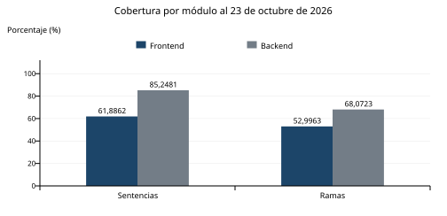
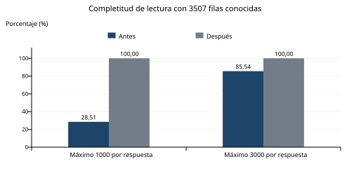
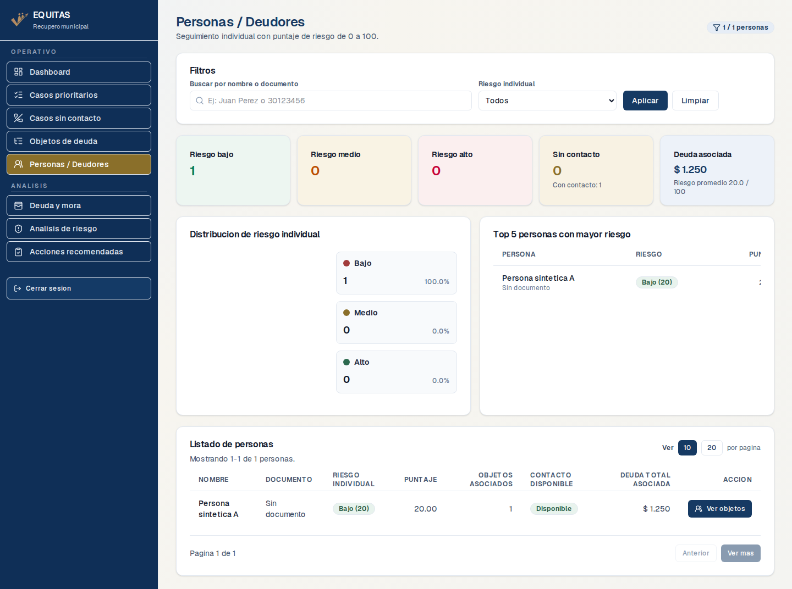
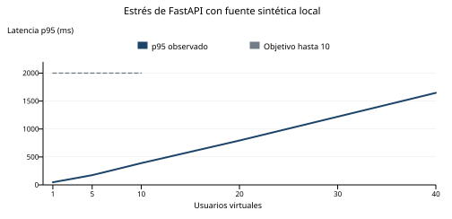

# Calidad de Software


**UNIVERSIDAD CATÓLICA DE CÓRDOBA**

FACULTAD DE INGENIERÍA

INGENIERÍA DE SISTEMAS

**Trabajo Práctico Integrador**

Evaluación del primer MVP de EQUITAS

**Estudiantes**

Ignacio Magoia

Axel Azcune

Imanol Decara

Nivel 2 Prototipo parcial

Córdoba, 2026

Presentación 26 de octubre de 2026

Corte de resultados 23 de octubre de 2026

<!-- salto -->

## 1 Introducción

El presente trabajo práctico tiene como objetivo evaluar y mejorar la calidad del primer MVP de EQUITAS, un sistema desarrollado para facilitar la gestión y el recupero de deudas municipales. La plataforma permite centralizar información sobre deudas, contribuyentes y objetos asociados, ofreciendo herramientas para visualizar indicadores, analizar niveles de riesgo y mora, identificar casos prioritarios y facilitar la toma de decisiones.

Desde el punto de vista tecnológico, EQUITAS cuenta con una interfaz web desarrollada en Next.js y React, componentes de procesamiento en Python y una base de datos gestionada mediante Supabase. Incorpora un proceso ETL que extrae, transforma y prepara información proveniente de archivos TSV. La web consulta Supabase directamente; los servicios FastAPI se evalúan como un componente independiente, sin atribuirles un consumo desde el frontend que no está implementado.

Para este trabajo se seleccionó el **Nivel 2, prototipo parcial**. Aplicamos pruebas unitarias, de componentes, de integración simulada y real, análisis estático, cobertura, smoke posterior al despliegue y dos campañas de rendimiento. El propósito es detectar problemas, reducir incertidumbre y apoyar las decisiones de calidad en resultados del propio proyecto.

El avance recibido contenía 94 pruebas aprobadas y una integración omitida. La continuidad agregó un defecto funcional con contraste rojo/verde, gates verificables, integración real en Supabase de testing, un recorrido de navegador desplegado y cargas con criterios previos. El corte acumulado es de **183 pruebas o campañas de producto aprobadas**, con **66 controles de infraestructura separados**. Esas cifras reúnen ejecuciones identificadas; no corresponden a un único workflow.

Los resultados aportan confianza sobre los casos y entornos ensayados. Persiste la autorización permisiva del Supabase original. OBS-DEP-001 se cerró en E11 por retiro oficial del aviso y auditoría nueva sin hallazgos, sin atribuirlo a una actualización de paquetes. No se realizaron aceptación municipal, auditoría integral de seguridad o restauración de backups. La validación técnica de demostración está ejecutada; la preparación oral individual y la entrega académica requieren confirmación del equipo.

### Versiones y evidencia utilizada

El corte técnico es el commit **5b62c14c8186b1ea79c4d4c2aa7dfb8acbb26198**, del 23/10/2026, con [CI testing 40032393112 aprobado](https://github.com/ImaDecara/Tesis-EQUITAS/actions/runs/40032393112). Los ZIP de sus cuatro jobs fueron descargados y contrastados con el SHA-256 informado por GitHub. El resumen, gate e integración real se conservan en [evidencias E11](../evidencias/e11/ci-summary.json).

CI, integración real, nuevo Preview/smoke y cargas E11 corresponden al mismo **5b62c14**. El [CI 40032393112](https://github.com/ImaDecara/Tesis-EQUITAS/actions/runs/40032393112) parte de checkouts nuevos en Ubuntu e instala dependencias fijadas; los cuatro jobs obligatorios aprobaron. El [smoke 40032558356](https://github.com/ImaDecara/Tesis-EQUITAS/actions/runs/40032558356) y las [cargas 40032355979](https://github.com/ImaDecara/Tesis-EQUITAS/actions/runs/40032355979) conservan la procedencia. El [manifiesto integral](../evidencias/e11/validacion-integral.json) permite revisar IDs, resultados y límites. Las versiones E03/E07/E08 se conservan como historia identificada. Los commits posteriores de cierre agregan informe, guion, controlador y evidencia; el árbol de producto probado permanece sin cambios.

## 2 Arquitectura del sistema

EQUITAS separa la interfaz de usuario, el procesamiento y el almacenamiento. Next.js, React y TypeScript implementan dashboards y vistas de consulta. Python y Pandas implementan extracción, transformación y carga; FastAPI expone operaciones de scoring y agrupación. Supabase proporciona Postgres, autenticación y Data API; Vercel publica la web.

El flujo implementado comienza con archivos TSV procesados por el ETL. Los datos preparados se cargan en Supabase y la web los consulta para componer indicadores y listados. La autenticación identifica al usuario de Auth, su registro de aplicación y su pertenencia activa a un tenant u organización. Las políticas de seguridad por fila, RLS, deben aplicar ese aislamiento en la base, además de los controles del cliente.

La API FastAPI obtiene perfiles y objetos mediante su conector y aplica filtros, scoring, agrupaciones, paginación y resumen. Esas rutas se prueban por separado. En las cargas sustituimos únicamente la fuente de datos por una fuente sintética local, manteniendo handlers y lógica de procesamiento productivos. No medimos el recorrido web ni la capacidad de Supabase con ese ensayo.

| Componente | Flujo realmente implementado | Pruebas principales |
| --- | --- | --- |
| Web Next.js y React | Navegador y servidor web consultan Auth/Data API de Supabase. | Unidad, presentación aislada, integración simulada, HTTP real y smoke desplegado. |
| ETL Python y Pandas | TSV, extracción, transformación, payload y carga. | Fixtures temporales, reglas, deduplicación, idempotencia y reintentos simulados. |
| FastAPI y scoring | Rutas HTTP y servicios de clasificación, filtrado y resumen. | Componentes, TestClient y cargas HTTP con fuente sintética. |
| Supabase testing | Dos tenants, cuatro identidades y filas conocidas. | Autenticación real, lectura autorizada, aislamiento y DML denegado al cliente normal. |
| Vercel Preview | Web desplegada con configuración limitada a la rama de testing. | Identificación de build y recorrido de navegador posterior al despliegue. |

El Supabase original **folyslqzqvnpolexcxjo** conserva cartera real y se utilizó para inspección de lectura. El entorno aislado **iylwghgvtydpmwidojdo** contiene únicamente fixtures sintéticas del TP. La separación impide usar cambios o cargas de demostración sobre la cartera original. [Arquitectura y alcance del plan](../PLAN_PRUEBAS_CALIDAD.md).

## 3 Nivel declarado y objetivos de calidad

Seleccionamos Nivel 2 porque existen interfaz, autenticación, consultas, ETL y servicios de cálculo operativos, pero la tesis continúa como prototipo en validación. El nivel es el avance declarado; no equivale a una aprobación académica o a preparación productiva completa.

La consigna exige, para ese nivel, cobertura de sentencias existente de al menos 60 %, cobertura de código nuevo de al menos 80 %, gate ante críticos y duplicación mayor al 5 %, integración real y smoke por pipeline después del despliegue, además de estrés con resultados y umbrales. También se ejecutó esfuerzo sostenido para cubrir el entregable transversal solicitado.

| Interesado | Objetivo medible | Resultado al corte |
| --- | --- | --- |
| Usuario municipal | Recuperar 100 % de los IDs autorizados esperados, sin ausencias ni duplicados, incluyendo más de 3.000 filas. | 3.507/3.507 por ruta y variante en el ensayo aislado; complementado con datos reales pequeños conocidos. |
| Usuario municipal | Cero filas de negocio ajenas a su tenant y acceso positivo conservado. | Cumple en testing. Incumplido en el original, que conserva políticas permisivas. |
| Usuario municipal | Recorrido básico desplegado aprobado con versión y destino correctos. | Una campaña smoke con cinco comprobaciones aprobadas. No es validación de usabilidad municipal. |
| Equipo | Cero fallos u omisiones en suites obligatorias y regresión por defecto declarado corregido. | CI actual 180/180 de producto; regresiones DAT, RLS testing y filtro. Infraestructura 66/66 aparte. |
| Equipo | Sentencias existentes ≥60 %, líneas nuevas ≥80 % por módulo y duplicación por líneas ≤5 %. | Cumple con numeradores, denominadores y base fija identificados. |
| Organización | Evitar datos inconsistentes y reanudar cargas con controles verificables. | ETL simulado e inspección SQL seleccionada aprobados; recarga real completa y recuperación cloud no ensayadas. |
| Organización | Entrega reproducible con versión, comandos, evidencias e informe. | Repositorio, reportes, informe y ensayo técnico E11 disponibles; repaso individual y entrega oral pendientes de confirmación. |

La [matriz de metas del plan](../PLAN_PRUEBAS_CALIDAD.md) conserva objetivos adicionales, criterios y evidencias. Los objetivos operativos no se presentan como acuerdos de servicio firmados por el municipio.

## 4 Plan y estrategia de pruebas

Priorizamos completitud de cartera, autorización y consistencia del ETL por su impacto. Combinamos pruebas rápidas con dobles controlados, integración HTTP real y un recorrido de navegador. Las cargas evalúan un componente delimitado. Las fixtures sintéticas y los archivos temporales evitan modificar información real.

Los criterios de entrada son una versión conocida, dependencias fijadas, caso y esperado identificados, entorno autorizado y capacidad de conservar reportes. Para externos se exige la configuración de testing; para cargas, dataset, concurrencia, duración, aceptación y parada anteriores al ensayo. La salida requiere resultados verificables, registro de defectos, trazabilidad y límites explícitos. Una omisión nunca cuenta como aprobación.

El responsable de continuidad técnica y seguimiento es Axel Azcune, cuenta AxAzc. Ignacio Magoia, Axel Azcune e Imanol Decara integran el equipo académico. El historial conserva cambios de frontend del avance recibido, ETL/backend y continuidad de calidad, sin inferir horas ni porcentajes de esfuerzo por cantidad de commits. [Aportes trazables](../APORTES_TP_CALIDAD.md).

### Entornos y cantidades actuales

El CI usa Ubuntu 24.04, Node 22.23.2, npm 11.21.1 y Python 3.12.14 con dependencias fijadas. E01 comprobó instalación nueva en Windows y E02 ejecución Linux. La versión actual integral está verificada en Linux; no se afirma que se repitió completa en todas las plataformas.

| Grupo disjunto de producto | Aprobadas | Alcance y límite |
| --- | ---: | --- |
| Frontend unidad y componentes | 66 | Auth 20, lector 20, paginación 5, riesgo/mora 6, mapper/selectores 3, recomendaciones 7, build-info 5. Incluye servicios con dobles. |
| Frontend presentación aislada | 11 | Nueve casos de páginas de datos y dos de páginas estáticas, sin navegador autenticado. |
| Frontend integración simulada | 30 | Auth 4, lectura completa 22 y loader 4; no son políticas cloud reales. |
| Backend unidad y componentes | 48 | Extracción, transformación, carga, scoring y utilidades. |
| Backend API en proceso | 5 | FastAPI TestClient con dependencias controladas. |
| Backend integración ETL simulada | 8 | Pipeline 3 y loader 5; TSV temporal, idempotencia y reintentos con dobles. |
| Supabase HTTP real | 12 | Auth/Data API de testing con cliente normal y lógica productiva. |
| Sistema smoke desplegado | 1 campaña | Cinco comprobaciones dentro de un recorrido. |
| Rendimiento del componente | 2 campañas | Estrés progresivo y sostenido. |
| Total acumulado | **183** | Cero fallidas u omitidas en los cortes aceptados; fuentes y versiones diferenciadas. |

La pirámide tiene **114** pruebas de unidad/componentes y **11** de presentación aislada en la base; **43** de integración simulada/API en el siguiente grupo; **12** externas y **un** smoke. Las dos cargas complementan el mapa como pruebas no funcionales. Los **66 controles de infraestructura** verifican gates, procedencia, configuración, secretos y reportes; quedan fuera del contador de producto.

El [inventario nominal](../calidad/inventario-pruebas.json) y los [JUnit del corte de referencia](../evidencias/e09/frontend-tests.xml) permiten contrastar cada grupo. Una parametrización puede producir varias instancias con el mismo nombre visible; los conteos se contrastan como instancias del runner, sin eliminar variantes por coincidencia de nombre. Los 56 IDs o familias del catálogo tampoco equivalen a 56 nuevas pruebas.

## 5 Pruebas dinámicas y técnicas aplicadas

### Ejemplo real de Arrange Act Assert

El primer caso de [pagination.test.ts](../front/tests/unit/pagination.test.ts) usa 25 valores conocidos, llama a paginateItems sin página/tamaño y exige diez elementos en la primera página y tres páginas totales. Integra las cinco variantes de paginación aprobadas en CI.

```typescript
// Arrange
const items = Array.from({ length: 25 }, (_, index) => index + 1)

// Act
const result = paginateItems(items, undefined, undefined)

// Assert
expect(result.pageSize).toBe(10)
expect(result.currentPage).toBe(1)
expect(result.items).toEqual([1, 2, 3, 4, 5, 6, 7, 8, 9, 10])
expect(result.currentStart).toBe(1)
expect(result.currentEnd).toBe(10)
expect(result.totalPages).toBe(3)
```

El esperado es concreto y no se obtiene copiando el algoritmo. Los otros casos comprueban última página parcial, entradas inválidas, página fuera de rango y listado vacío. La secuencia comprobada de prueba anterior a la corrección corresponde a DAT-06; no atribuimos TDD a todo el desarrollo histórico.

### Equivalencias y valores límite

| Familia real | Particiones o límites ejecutados | Resultado esperado y comprobado |
| --- | --- | --- |
| DAT-01 a DAT-06 | N=0/7/1.000/1.001/2.000/3.507; máximo servidor 1.000/3.000/137. | Fin de lectura correcto, todas las filas conocidas, cero ausencias y duplicados en ambas rutas. |
| DAT-07 a DAT-14 | Sin cliente, error API/transporte, respuesta no array, ID inválido, bigint en texto, cursor repetido o desordenado. | Advertencia/terminación según contrato y sin éxito aparente con datos parciales. |
| AUTH-01 a AUTH-09 | Sin configuración o sesión; error Auth; usuario ausente; pertenencia activa, inactiva, ausente o fallida. | Rechazo o contexto exacto; no consultar tablas cuando no corresponde. Alcance aislado con dobles. |
| Riesgo y mora | 0/39/40/69/70/100; NaN/−15/250; fechas inválidas, pasadas y futuras. | BAJO hasta 39, MEDIO de 40 a 69, ALTO desde 70; normalización y mora sin antigüedad negativa. |
| GATE-01 a GATE-03 | 59,99/60 % existente; 79,99/80 % nuevo; 5/5,01 % y 5,0001 % de duplicación. | Aceptación exacta en el límite y rechazo del exceso sin ocultarlo por redondeo. Infraestructura aparte. |

Estas familias reemplazan los CP-01 a CP-04 ilustrativos del avance recibido. Sus [fichas](../CASOS_PRUEBA_CALIDAD.md) y [trazabilidad](../TRAZABILIDAD_CALIDAD.md) enlazan entradas, esperado, obtenido, versión y ticket. No se afirma exhaustividad de combinaciones ni cobertura MC/DC.

### Tabla de decisión ejecutada de recomendaciones

REC-01 conserva siete variantes de [recommendation-decisions.test.ts](../front/tests/unit/recommendation-decisions.test.ts). Todas aprobaron en E04 y en el corte actual. Se verifican tipo, resumen, urgencia y motivo no vacío.

| Regla | Riesgo y contacto | Vencida / total / días | Esperado igual al obtenido | Urgente |
| --- | --- | --- | --- | --- |
| D1 | ALTO, con contacto | 1 / 400.000 / 90 | Llamado prioritario | Sí |
| D2 | ALTO, sin contacto | 0 / 0 / 0 | Plan de pago / revisión humana | Sí |
| D3 | MEDIO, con contacto | 1 / 1 / 60 | Plan de pago / revisión humana | Sí |
| D4 | MEDIO, con contacto | 1 / 1 / 59 | Mensaje recordatorio | No |
| D5 | BAJO, con contacto | 0 / 350.000 / 60 | Mensaje recordatorio | No |
| D6 | BAJO, sin contacto | 0 / 349.999 / 90 | Seguimiento posterior | No |
| D7 | BAJO, con contacto | 0 / 0 / 0 | Seguimiento posterior | No |

D1 comprueba precedencia de riesgo alto; D3/D4 cambia solo el umbral de días. D5/D6 ejercitan ambos lados del saldo límite, pero también cambian otras entradas, por lo que no son un experimento de una única variable. Las siete filas son la selección ejecutada, no todas las combinaciones posibles. La [matriz Auth](../CASOS_PRUEBA_CALIDAD.md#tabla-de-decisión-ejecutada-acceso-de-aplicación-aislado) agrega decisiones de acceso con dobles; la sección 11 presenta su complemento real.

### Siete principios del testing

Los principios de [ISTQB CTFL v4.0.1, sección 1.3](https://www.istqb.org/wp-content/uploads/2024/11/ISTQB_CTFL_Syllabus_v4.0.1.pdf) se aplican a decisiones del proyecto:

| Principio | Aplicación comprobable en EQUITAS |
| --- | --- |
| Presencia de defectos | Los cuatro DAT-06 rojos detectaron truncamiento. El verde confirma esa corrección en el alcance ensayado, sin demostrar ausencia de otros defectos. |
| Exhaustividad imposible | Se seleccionaron volúmenes, límites, identidades y operaciones según riesgo; no todos los estados de red, fechas o roles posibles. |
| Pruebas tempranas | DAT-06 publicó esperado/aserciones antes del arreglo. E08 fijó SLO, dataset y parada antes de las cargas, en 09f040b. |
| Agrupamiento | Lectura, autorización y ETL reciben prioridad por impacto y complejidad. Los pocos defectos registrados no demuestran una distribución estadística 80/20. |
| Renovación de casos | Se agregaron gran volumen, errores intermedios y dos tenants; el smoke corrigió su selector de Personas e incorporó la aserción del input de Limpiar. |
| Dependencia del contexto | El MVP municipal prioriza completitud y aislamiento; utiliza testing sintético y carga delimitada para no afectar cartera real. |
| Falacia de ausencia de errores | Aprobar 183 resultados no prueba utilidad municipal, accesibilidad completa o seguridad del original. Las metas parciales y los tickets abiertos se conservan. |

La explicación detallada y las fuentes de cada aplicación se conservan en [Proceso y técnicas](../PROCESO_Y_TECNICAS_CALIDAD.md).

## 6 Modelo de calidad ISO 25010

Se utiliza el modelo de ocho características de **ISO/IEC 25010:2011**, correspondiente a la enumeración solicitada por la consigna. La [ficha oficial ISO](https://www.iso.org/standard/35733.html) identifica esa edición y sus sucesoras; no la presentamos como la edición vigente ni como una certificación. La matriz evalúa objetivos seleccionados del MVP, no todas las subcaracterísticas del estándar.

| Característica y objetivo | Métrica y aceptación | Resultado y evidencia | Estado al corte |
| --- | --- | --- | --- |
| Adecuación funcional: cartera completa y reglas correctas. | 100 % de IDs conocidos sin ausencias/duplicados; REC-01 7/7. | 3.507/3.507 por ruta/variante y siete decisiones exactas. DAT-06 y REC-01. | Cumple en el alcance técnico seleccionado; reglas municipales completas no validadas. |
| Eficiencia: respuestas correctas bajo carga declarada. | Hasta 10 usuarios: p95≤2 s, error≤1 %, cero contenido incorrecto; sostenido 600 s. | E11: p95 501,80 ms a 10 usuarios y 360,06 ms sostenido; dos campañas de CI. | Cumple en el componente/fuente sintética del ensayo; no capacidad cloud o web. |
| Compatibilidad: interoperar con Auth/Data API. | 12/12 HTTP sin omisiones y metadata de despliegue concordante. | Cliente normal y funciones productivas en Supabase testing; smoke con destino correcto. | Parcial: sin coexistencia ni matriz de proveedores/navegadores. |
| Usabilidad: recorrido básico y limpieza de filtros. | Cinco comprobaciones del smoke; input, URL y listado restaurados. | Smoke E11 y rojo/verde E07 de DEF-UI-001. No se midió satisfacción o aprendizaje municipal. | Parcial técnico; aceptación municipal y accesibilidad completa no verificadas. |
| Fiabilidad: evitar éxito parcial e inconsistencias. | Negativos DAT seguros; 8/8 ETL simuladas y cero fallos obligatorios. | Suites y sostenido aprobados; contingencia documentada y fixtures recreadas. | Parcial: sin disponibilidad anual, failover, RTO/RPO ni backup restore medidos. |
| Seguridad: aislar tenants y conservar acceso positivo. | Cero negocio ajeno para A/B/none/inactive; cliente normal sin DML; cero avisos críticos/productivos. | 12/12 HTTP; audit E11 completo/productivo 0/0; DEF-SUP-001 original abierto. | Testing cumple aislamiento ensayado; original incumple restricción equivalente. |
| Mantenibilidad: proteger regresión y análisis. | Sentencias≥60 %, líneas nuevas≥80 %, duplicación≤5 %, cero estáticos no aceptados. | Front 61,8862 %, back 85,2481 %; nuevo 36/36 y 15/17; duplicación 3,8265 %. | Cumple criterios seleccionados; persisten ramas sin cubrir y tres excepciones Ruff. |
| Portabilidad: preparación local y runner reproducibles. | Instalación Windows E01 y Linux E02; CI actual completo aprobado. | Dependencias fijadas, 180/180 de producto y 66 controles de CI; PoC Windows/cargas Ubuntu. | Parcial: no toda la versión actual en Windows, macOS u otro proveedor. |

Fuentes: [matriz desarrollada](../MATRIZ_ISO25010_CALIDAD.md), [gate actual](../evidencias/e11/ci-gate.json), [HTTP real](../evidencias/e11/supabase.json), [smoke](../evidencias/e07/smoke.json) y [cargas](../evidencias/e08/resultados.json). Los criterios de gates y carga tienen versiones previas; la matriz consolidada el 23/10 no simula una aceptación municipal anterior.

El orden de prioridad es **1 adecuación funcional, 2 seguridad, 3 fiabilidad**. La cartera incompleta puede distorsionar decisiones de recupero incluso con una interfaz disponible. La seguridad impide exposición de información fuera de la organización y mantiene un pendiente crítico en el original. La fiabilidad sostiene consultas/importaciones consistentes y controladas ante fallos. La prioridad de una característica no sustituye la urgencia de un defecto concreto: DEF-SUP-001 original exige atención aunque ocupe el segundo eje del modelo.

## 7 Análisis estático y mantenibilidad

El análisis estático detecta problemas sin ejecutar el comportamiento funcional. Usamos ESLint para TypeScript/React, Ruff para Python y jscpd para duplicación; su complejidad orientativa ayuda a seleccionar módulos para revisar. Los hallazgos estáticos, las vulnerabilidades de dependencias y los defectos funcionales son conjuntos diferentes.

| Control | Base observada el 21/10 | Tratamiento y resultado actual |
| --- | --- | --- |
| ESLint | Cero errores/advertencias en 70 archivos. | Cero errores/advertencias en 81 archivos; alcance creció con pruebas. |
| Ruff 0.17.1 | 19 hallazgos en 8 archivos. | 16 corregidos y tres excepciones locales TRY004 justificadas; cero no aceptados con las mismas 407 reglas habilitadas. |
| Duplicación por líneas | 474/11.188=4,2367 %,38 clones. | 427/11.159=3,8265 %,36 clones; cumple≤5 %. |
| Duplicación por tokens | 2.742/53.179=5,1562 %. | 2.533/53.287=4,7535 %; medida distinta del gate por líneas. |
| Audit completo frontend | 19 paquetes afectados: 4 críticos, 12 altos, 2 moderados, 1 bajo. | E11: cero avisos y salida 0, sin modificar el lockfile. E01-E10: cinco altos dev, salida 1. |
| Audit productivo frontend | Se informa por separado. | Cero avisos, salida 0. E11 verifica también audit completo en cero. |

En Ruff se corrigieron imports, variables/importaciones sin uso y otras observaciones, manteniendo tres `noqa` TRY004 locales por contrato ValueError. Ignorar los `noqa` vuelve a mostrar esas tres excepciones. **16/19=84,21 %** de hallazgos iniciales fueron corregidos; los tres restantes no se presentan como arreglos. La severidad media/baja del informe recibido era un triage del equipo, no una clasificación nativa de Ruff. [Antes, después y excepciones E01](../REGISTRO_EJECUCION_E01.md).

Las actualizaciones E01 redujeron el audit completo de 19 a 5 paquetes afectados, una disminución descriptiva de 73,68 %. En E11 el resultado pasó de cinco altos dev a cero porque [GitHub retiró GHSA-vfj7-8cjw-p6xm](https://github.com/advisories/GHSA-vfj7-8cjw-p6xm) el 23/10/2026 a las 12:53:02 UTC, por no considerarlo prácticamente explotable. El lockfile no cambió: esta segunda reducción no es una corrección de código ni una actualización de dependencias. Los reportes históricos conservan sus hallazgos. [Auditoría actual](../evidencias/e11/audit-all.json), [decisión](../evidencias/e11/audit-decision.json) y [ticket cerrado](https://github.com/ImaDecara/Tesis-EQUITAS/issues/3). La excepción no se prorrogó, no se utilizó en esta ejecución y conserva su vencimiento histórico 26/10; hallazgos nuevos siguen requiriendo revisión.

La extracción del lector común en E03 acompaña la reducción de clones y evita repetir el contrato de paginación. También cambiaron tamaño y versión de jscpd desde la base; por eso no atribuimos toda variación porcentual a una intervención aislada. La complejidad orientativa sigue señalando transformación, mapper de objetos, scoring y carga ETL; no se tomó como certificación independiente ni se fijó un umbral retrospectivo para aprobarla.

## 8 Cobertura y evolución de métricas

### Alcance y medidas actuales

La cobertura incluye `front/app`, `front/components`, `front/lib`, `back/ETL`, `back/api` y `back/services`. No representa todos los archivos del repositorio; por ejemplo, `front/proxy.ts` no está en la base frontend configurada. Se conserva el alcance y se informan cambios de denominador, sin excluir archivos para forzar porcentajes.

Cada porcentaje se calcula como 100×elementos cubiertos/elementos instrumentados. El gate usa el cociente sin redondear. Vitest presenta algunos valores truncados a dos decimales: el cociente 794/1.283 es 61,8862 %, mientras el reporte muestra 61,88 %.

| Indicador actual | Numerador y denominador | Porcentaje e interpretación |
| --- | --- | --- |
| Sentencias frontend | 794/1.283 | **61,8862 %**, Vitest 61,88 %; supera 60 %. Quedan 489 sin cubrir. |
| Líneas frontend | 746/1.209 | 61,7039 %, reporte 61,70 %; no confundir con sentencias. |
| Funciones frontend | 200/326 | 61,3497 %, reporte 61,34 %; 126 no cubiertas. |
| Ramas frontend | 566/1.068 | **52,9963 %**, reporte 52,99 %; 502 sin cubrir. |
| Sentencias backend | 1.254/1.471 | **85,2481 %**, supera 60 %; 217 sin cubrir. |
| Ramas backend | 339/498 | **68,0723 %**; 159 sin cubrir. |
| Combinada backend | (1.254+339)/(1.471+498) | **80,9040 %**; terminal muestra 81 %. No es promedio simple ni cobertura de sentencias. |
| Funciones backend | No disponible en el reporte usado. | No medida; no se informa cero ni un denominador inventado. |
| Líneas ejecutables nuevas frontend | 36/36 | **100 %**, supera 80 %. |
| Líneas ejecutables nuevas backend | 15/17 | **88,2353 %**, supera 80 % por módulo; dos líneas sin cubrir. |

La base fija de código nuevo es **531996f51243dc3d4c5a607338e2f35e32313f6b**. El gate identifica el diff y las líneas ejecutables nuevas; un archivo sin líneas ejecutables nuevas es no aplicable, no un 100 % medido. La cobertura de ramas aporta evidencia de decisiones instrumentadas, sin probar todas las condiciones o MC/DC. No sumamos porcentajes frontend/backend ni usamos el campo frontend `branchesTrue` de denominador cero como una medida útil.



Figura 1. Sentencias y ramas por módulo, 23/10/2026, SHA 5b62c14. Fuente: resumen y gate del CI 40032393112. Barras calculadas con los cocientes exactos; el texto conserva además la presentación de cada herramienta.

### Evolución y comparabilidad

| Momento y versión | Frontend sentencias | Backend sentencias | Interpretación |
| --- | --- | --- | --- |
| Antecedente recibido | 12,03 %→60,43 % | 26,83 %→85,26 % | Evolución informada; no se reprodujo el extremo inicial sobre un commit antiguo. |
| Diagnóstico 21/10,531996f | 3.372/5.580=60,4301 % | 1.255/1.472=85,2582 % | Extremo final recibido corroborado; combinada backend 80,9137 %. |
| E01, cambios sobre a96b482 | 586/1.275=45,9608 % | 1.254/1.471=85,2481 % | Vitest/V8 pasa 3.2.4→4.1.12 con mismos 54 archivos; backend pierde una sentencia por corrección estática. |
| E03,3bfe156 | 742/1.280=57,9688 % | 1.254/1.471=85,2481 % | Lector común/regresiones; todavía bajo 60 %. |
| E04, c95a9ab | 791/1.280=61,7969 % | 1.254/1.471=85,2481 % | Mismo método/denominador E03, más 49 sentencias cubiertas; cierra insuficiencia. |
| E06,4bb783f | 788/1.277=61,7071 % | 1.254/1.471=85,2481 % | Ajuste Auth productivo, cambia denominador. |
| E07, a6497a7 y corte 5b62c14 | 794/1.283=61,8862 % | 1.254/1.471=85,2481 % | Build-info y regresión del filtro; sin cambio posterior del producto. |

Fuente histórica: [informe recibido](../tp-Calidad.md), [diagnóstico inicial](../evidencias/validacion-2026-10-21.json) y fichas de ejecución. La mejora histórica reportada es de 48,40 y 58,43 puntos porcentuales, sin atribuirle una reproducción experimental nueva. La caída frontend 60,43→45,96 % se debe al cambio de remapeo AST de V8 con iguales archivos, y **no demuestra una regresión funcional**. E03→E04 sí conserva método/denominador y suma 49/1.280, equivalente a **3,8281 puntos porcentuales** por nuevas verificaciones.

### Métricas de proceso y proyecto

| Tipo y corte | Fórmula | Resultado y límite |
| --- | --- | --- |
| Proceso, base 531996f | Aprobadas/ejecutadas=94/(94+0). | 100 %; una externa omitida aparte. Ejecutadas/inventariadas=94/95=98,95 %; omitidas 1/95=1,05 %. No 95 aprobadas. |
| Proceso, CI actual 5b62c14 | (107 frontend+61 backend+12 reales)/180. | **180/180=100 %**, cero fallidas/omitidas. `summary.tests` suma 168 aisladas; 12 reales están en su campo/job. |
| Proceso, corte acumulado | (168 aisladas+12 reales+1 smoke+2 cargas)/183. | **183/183=100 %**, de distintas fuentes/versiones. No mide completitud de requisitos. |
| Proceso de infraestructura | 66 aprobadas/66 ejecutadas. | 100 %, aparte del producto. |
| Seguimiento 23/10 | Tickets cerrados/registrados=11/12. | 91,67 %, uno abierto. Mezcla campañas, observaciones y defectos; no es tasa de resolución de bugs. |
| Proyecto, base 531996f | Conteo del alcance productivo jscpd. | 62 archivos/11.188 líneas; no tamaño total del repositorio. |
| Proyecto, corte actual | Mismo tipo de conteo del alcance declarado. | 64 archivos/11.159 líneas; +2 archivos/−29 líneas. No mide productividad ni esfuerzo. |

Una tasa de aprobación alta refleja concordancia con los oráculos seleccionados. No mide defectos desconocidos, satisfacción municipal o seguridad total. No calculamos MTBF, disponibilidad anual o velocidad del equipo porque faltan series/horas observadas. [Diccionario y cálculos E09](../METRICAS_CALIDAD.md).

### Mejora comparable de completitud

DEF-DAT-001 se evaluó con el mismo dataset de **3.507 filas**, iguales IDs y aserciones en objetos/personas. Completitud=100×IDs únicos obtenidos/esperados; duplicados se controlan aparte.

| Máximo por respuesta del doble | Antes en cada ruta | Después en cada ruta | Diferencia |
| --- | --- | --- | --- |
| 1.000 | 1.000/3.507=28,5144 %; 2.507 ausentes. | 3.507/3.507=100 %; 0 ausentes/duplicados. | +71,4856 puntos porcentuales. |
| 3.000 | 3.000/3.507=85,5432 %; 507 ausentes. | 3.507/3.507=100 %; 0 ausentes/duplicados. | +14,4568 puntos porcentuales. |



Figura 2. Comparación DAT-06 del 21/10/2026, N=3.507 por ruta. Las barras representan cada máximo de respuesta; ambas rutas obtuvieron los mismos resultados. Fuente: comparacion-dat-06.json, rojo f155cfc y verde 3bfe156. Servicio simulado; no se representa una cartera municipal ampliada sumando variantes.

El lector corregido pagina por cursor `id` hasta agotar respuestas, sin otro tope total fijo. Se mantuvo el bloque inicial de aserciones y se verificaron relaciones/agregados entre páginas. La validación real E06 usa datos pequeños conocidos; no prueba 3.507 filas en Supabase real. La combinación aporta evidencias complementarias, sin ocultar esa diferencia.

## 9 Riesgos y contingencia

Probabilidad e impacto se estiman de 1 a 5. Prioridad=P×I: **15-25 crítica, 10-14 alta, 5-9 media, 1-4 baja**. Esta escala reemplaza la clasificación no uniforme del avance recibido. Las puntuaciones son estimaciones de planificación, no tasas históricas, explotación confirmada o severidades automáticas de analizadores.

| Riesgo | Inicial E00 | Residual estimado 23/10 | Tratamiento y estado |
| --- | --- | --- | --- |
| R-01 Indisponibilidad Supabase | 3×5=15 crítica | 3×5=15 crítica | Negativos/reintentos y protocolo; disponibilidad/failover no medidos. |
| R-02 Contexto Auth/tenant | 3×5=15 crítica | 1×5=5 media en testing | Contexto y denegaciones en 12 HTTP; repetir ante cambios de claims/esquema. |
| R-03 Inconsistencia ETL | 3×5=15 crítica | 2×5=10 alta | Ocho integraciones simuladas y SQL seleccionado; falta recarga real completa. |
| R-04 Lectura sin pertenencia | 2×5=10 alta | Original 4×5=20 crítica; testing 1×5=5 media | Exposición observada eleva urgencia original; defecto abierto allí. |
| R-05 Truncamiento | 4×4=16 crítica | 2×4=8 media | Cursor/regresión DAT-06; gran volumen real no ensayado. |
| R-06 Variables/despliegue | 2×4=8 media | 1×4=4 baja en Preview verificado | SHA/URL/proyecto y smoke; no califica producción ni prueba rollback. |
| R-07 Regresión | 3×4=12 alta | 2×4=8 media | Suites/gates/regresiones; siguen ramas sin cubrir. |
| R-08 Dependencias dev | Sin puntuación previa; seguimiento E01. | 2×3=6 media | Auditoría actual 0/0 por retiro del aviso; observar novedades, sin prorrogar excepción. |
| R-09 Pérdida de evidencia | Formalizado E09. | 1×3=3 baja | Artefactos 30 días, resúmenes/series/muestras versionados; algunos logs completos expiran. |

El responsable de seguimiento es Axel Azcune. La reducción estimada en testing no se extrapola al original; el CI verde tampoco reduce por sí solo su riesgo crítico. Si un agregado no concuerda, se advierte incompletitud y se evitan decisiones basadas en totales no conciliados. Si un lote ETL queda incierto, se detiene y se concilian claves, conteos e importes antes de repetirlo. [Plan y riesgos vigentes](../PLAN_PRUEBAS_CALIDAD.md#8-riesgos-priorizados).

### Protocolo ante fallo de Supabase

| Fase | Acción y criterio para avanzar |
| --- | --- |
| Detección | Registrar hora, entorno, SHA/URL, operación y error sin secretos. Distinguir disponibilidad, permisos, credencial, esquema o datos; consultar estado del proveedor/logs permitidos. |
| Contención | No presentar datos parciales como éxito. Detener lotes inciertos y respetar reintentos acotados. No repetir escrituras a ciegas ni sustituir testing por la cartera original para sostener una demo. |
| Comunicación | Axel coordina con equipo/administrador: impacto, posible desactualización, operaciones detenidas y próximo punto de revisión acordado. Registrar destinatario/medio/fecha sin prometer un SLA inexistente. |
| Recuperación | Verificar servicio/configuración/Auth y conciliar lote antes de reanudar. En testing recrear solo fixtures reservadas; pérdida real se escala al responsable y a su estrategia de backups. |
| Verificación y cierre | Repetir 12/12 HTTP sin omisiones, accesos positivos/negativos y montos conocidos. Si afectó web, nuevo CI/smoke del deployment correcto; si afectó ETL, casos y conciliación. Cerrar solo sin diferencias pendientes. |

Se probaron errores/reintentos con dobles y la limpieza/recreación real de fixtures reservadas: tras limpiar hubo cero cuentas/tenants/objetos/personas/currency; después se recrearon cuatro cuentas y datos sintéticos y aprobaron 12 HTTP. [Ciclo](../evidencias/e06/fixtures-lifecycle.json), [verificación posterior](../evidencias/e06/recreated-green.json).

El protocolo es planificación operativa. No se ensayó caída completa del proveedor, recuperación de cartera municipal, failover o backup/restore; recrear fixtures no equivale a restaurar una base. No se midieron ni prometen RTO o RPO. La comunicación indicada no se presenta como un incidente ya comunicado.

## 10 Aseguramiento y control de calidad

QA y QC son actividades complementarias. El aseguramiento de calidad previene problemas mediante criterios, configuración reproducible, revisión y gestión de riesgos. El control de calidad evalúa el producto mediante pruebas, análisis y mediciones. Los resultados de QC retroalimentan el proceso de QA; ejecutar una herramienta no convierte por sí mismo toda actividad en aseguramiento.

| QA aplicado | QC aplicado y resultado |
| --- | --- |
| Plan versionado, responsables y criterios de entrada/salida. | Diagnóstico inicial, 94 aprobadas y una omitida, cobertura y hallazgos registrados. |
| Resultado esperado DAT-06 anterior al arreglo. | Cuatro fallos reales, corrección y mismo bloque inicial de aserciones en verde. |
| Dependencias fijadas, base de diff y umbrales de gate estables. | Instalación nueva, build/análisis, cobertura y rechazo de evidencia inválida o críticos. |
| Testing separado, tenants/fixtures y secretos fuera de reportes. |12 HTTP reales y smoke sin datos ajenos ni errores de página/consola. |
| SLO, parada y pesos de herramienta publicados antes de ensayar. | PoC, estrés y sostenido con muestras nuevas de CI y análisis de límites. |
| Fichas/plantillas, estados y alcance de cierre definidos. | Tickets enlazados a esperado/obtenido, versión, corrección y regresión. |

La documentación se mantuvo durante la continuidad y se consolidó antes de la entrega. No se reconstruye una decisión previa cuando solo existe una evaluación retrospectiva. En particular, los pesos y SLO de E08 sí se versionaron antes de puntuar/ejecutar; la evaluación ISO consolidada conserva su fecha posterior. [Plan](../PLAN_PRUEBAS_CALIDAD.md), [proceso](../PROCESO_Y_TECNICAS_CALIDAD.md) y [gestión](../GESTION_CALIDAD.md).

## 11 Integración externa real con Supabase

La integración elegida es **Supabase**, suficiente para el requisito externo de la consigna. La investigación administrativa por plugin y las consultas SQL iniciales permitieron conocer tablas, volumen y políticas; no se cuentan como login de aplicación, ni como pruebas HTTP o recorridos de navegador.

E06 preparó EQUITAS-TP-TESTING con 23 tablas, 146 columnas y políticas de lectura basadas en pertenencia activa. Hay dos tenants reservados, A y B, y cuatro cuentas: A/B activas, none sin pertenencia e inactive con pertenencia inactiva. Las filas sintéticas conocidas permiten comprobar montos 1250/2500 y riesgos 20/80, además de IDs propios/ajenos. Los catálogos autorizados compartidos se distinguen de tablas de negocio. El proyecto original no se modificó.

Las pruebas usan Auth HTTP y Data API con clave publicable y JWT de usuario normal. Ejecutan `validateAuthUserTenantAccess` y `loadAllTableRows` productivos; no reemplazan SDK/transporte por mocks ni usan credencial administrativa para las aserciones. [Preparación y límites](../SUPABASE_TESTING_CALIDAD.md).

| Caso o variantes | Aceptación y resultado observado |
| --- | --- |
| SUP-AUTH-01, A/B, dos variantes | Contexto exacto de Auth, usuario de aplicación, tenant y rol. Ambas aprobaron. |
| SUP-AUTH-02 | Password incorrecto no crea sesión ni habilita lectura de negocio. Aprobó. |
| SUP-DATA-02, A/B, dos variantes | Filas, montos y riesgos conocidos mediante lector productivo. Ambas aprobaron. |
| SUP-RLS-01 | Anónimo recibe cero filas en las 23 tablas. Aprobó. |
| SUP-RLS-02 | Identidad autenticada sin membresía recibe cero negocio. Aprobó después del arreglo de testing. |
| SUP-RLS-03 y SUP-RLS-04 | A no consulta IDs de B y B no consulta IDs de A. Ambas aprobaron. |
| SUP-RLS-05 | Membresía inactiva conserva diagnóstico propio y deniega negocio. Aprobó. |
| SUP-AUTH-03 | Logout elimina sesión del cliente; la siguiente lectura es anónima. Aprobó. |
| SUP-WRITE-01 | Cliente normal no inserta, actualiza ni elimina negocio. Aprobó. |

Son **12 variantes aprobadas**, cero fallidas/omitidas, exigidas en el job real de main/testing. [Reporte del corte técnico](../evidencias/e11/supabase.json). La suite falla si falta configuración; la antigua prueba externa opcional/omitida no se mantiene como si hubiese aprobado.

Se conserva un contraste real de SUP-RLS-02 en testing: con política heredada permisiva, el usuario none obtuvo los IDs 910001 y 910002 cuando esperaba ninguno; después de aplicar pertenencia activa obtuvo cero y la campaña completa 12/12 aprobó. El hash del test fue idéntico antes/después. [Evidencia rojo/verde E06](../evidencias/e06/red-green.json).

**DEF-SUP-001 permanece abierto para el original.** Allí se observaron 23 políticas SELECT `TO authenticated USING(true)` y un rol sin pertenencia pudo contar 2.933 objetos, 56.286 deudas y 2.493 personas. Esa comprobación inicial fue SQL de solo lectura con rollback; no se presenta como explotación HTTP confirmada. Corregir testing y aprobar 12 HTTP no demuestra que el original haya cambiado. [Registro del defecto](../REGISTRO_DEFECTOS_CALIDAD.md), [ticket#1](https://github.com/ImaDecara/Tesis-EQUITAS/issues/1).

## 12 Automatización y despliegue verificado

### Pipeline y quality gates

[quality-ci.yml](../.github/workflows/quality-ci.yml) se ejecuta por push, PR hacia main y dispatch. Prepara entornos fijados, instala dependencias, ejecuta frontend/backend, build/TypeScript, ESLint/Ruff, cobertura, duplicación y auditoría; publica JSON, JUnit y HTML. Los reportes se conservan también al fallar y el resumen propaga un estado no exitoso. Los artefactos se retienen 30 días; los snapshots portables evitan depender solo de esa ventana.

La integración real es obligatoria en push/dispatch de **main y quality/tp-testing**. No se entregan secretos a cualquier PR o rama. El resumen exige su éxito donde corresponde; un verde de una rama sin ese job no acredita integración real. El [CI del corte 5b62c14](https://github.com/ImaDecara/Tesis-EQUITAS/actions/runs/40032393112) aprobó los cuatro jobs, con 168 aisladas, 12 HTTP y 66 controles de infraestructura.

Los criterios exactos del gate son: sentencias existentes≥60 % por módulo; líneas ejecutables nuevas≥80 % por módulo contra base fija 531996f; duplicación por líneas≤5 % sin redondear; cero hallazgos críticos según clasificador del proyecto y cero estáticos no aceptados. Evidencia ausente, inválida o de otra procedencia bloquea. La auditoría tiene política separada: cero críticas/productivas y solo la excepción dev exacta vigente.

El clasificador crítico incluye las reglas ESLint `constructor-super`, `no-unreachable`, `no-unsafe-finally` y Ruff `F821`, `F822`, `F823`, `invalid-syntax`. Es una decisión del proyecto, no severidad nativa de Ruff ni garantía de detectar todo bug crítico funcional o de seguridad. [Política y gate del corte](../evidencias/e11/ci-gate.json). El campo `release_approved=false` se conserva: aprobar controles técnicos no equivale a habilitar producción.

### Pipeline rojo por un defecto real y verde posterior

| Ejecución | Versión y causa | Resultado |
| --- | --- | --- |
| [Rojo 39672114249](https://github.com/ImaDecara/Tesis-EQUITAS/actions/runs/39672114249) | [f155cfc](https://github.com/ImaDecara/Tesis-EQUITAS/commit/f155cfc1616c8edeacd533241c5dc2858745734a); consultas únicas truncaban las 3.507 filas esperadas en objetos/personas. |95 aprobadas, 4 fallidas y 1 omitida; frontend/resumen fallaron. No fue una inyección sintética. |
| [Verde 39673351642](https://github.com/ImaDecara/Tesis-EQUITAS/actions/runs/39673351642) |3bfe15688a72360b336b7d8732867c6991a1d42e; lector común por cursor. |136 aprobadas, 0 fallidas y 1 omitida; 14 controles de infraestructura aparte. |
| [CI integral actual 40032393112](https://github.com/ImaDecara/Tesis-EQUITAS/actions/runs/40032393112) |5b62c14; suites/gates e integración real obligatorios en main/testing. |180/180 de producto, 0 omitidas/fallidas; 66 controles de infraestructura aparte. |

Se conservó el bloque original de cuatro aserciones de DAT-06; la suite verde agregó casos, por lo que no se afirma que todos los denominadores rojo/verde sean iguales. La evidencia comparable está en esas cuatro variantes y en el mismo dataset. [Manifiesto E03](../evidencias/e03/ejecuciones-2026-10-21.json).

Además, E04 verificó un [bloqueo crítico controlado](https://github.com/ImaDecara/Tesis-EQUITAS/actions/runs/39677574162) y un [CI normal verde](https://github.com/ImaDecara/Tesis-EQUITAS/actions/runs/39677574195), ambos en c95a9ab. La inyección demuestra el mecanismo del gate y no sustituye el defecto real E03. El bloqueo de imports I001 en E08 fue una dificultad de preparación distinta de un fallo funcional de rendimiento.

### Smoke posterior al despliegue

[preview-smoke.yml](../.github/workflows/preview-smoke.yml) se dispara después del CI de la rama persistente **quality/tp-testing**. Exige CI correcto del mismo SHA, identifica el deployment de Vercel y comprueba metadata `/api/build-info`, URL, rama y proyecto Supabase antes de navegar. El flujo usa las fixtures de testing y conserva la protección del deployment; no publica el secreto de automatización.

El despliegue aceptado es [tesis-equitas-lilpc7spm-equitas.vercel.app](https://tesis-equitas-lilpc7spm-equitas.vercel.app), SHA 5b62c14,23/10/2026. El [smoke automático 40032558356](https://github.com/ImaDecara/Tesis-EQUITAS/actions/runs/40032558356) aprobó sus cinco comprobaciones: disponibilidad/metadata, login real A, dashboard con 1250 y sin B, navegación/filtro/listado operativo de Personas, y logout seguido de acceso protegido denegado. Son cinco comprobaciones de **una campaña**, con cero errores de página/consola.

El primer selector de Personas no comprobaba realmente esa ruta. Se agregó URL/título y se acotó la aserción a la tabla operativa. Esa revisión descubrió **DEF-UI-001**: Limpiar restauraba URL y listado, pero conservaba el input anterior. La misma aserción de campo vacío falló en 0e4e84a y aprobó en a6497a7 tras restablecer el formulario al cambiar filtros. [Rojo/verde del filtro](../evidencias/e07/filtro-rojo-verde.json), [defecto#11](https://github.com/ImaDecara/Tesis-EQUITAS/issues/11). Las capturas de ensayos previos quedan como diagnóstico y no como prueba de cierre.



Figura 3. Detalle del listado operativo, recortado de la captura real de E07 del 23/10/2026, a6497a7: Personas muestra la fixture A, riesgo 20 e importe 1250. Procede del smoke 39955572523, no de una nueva ejecución al elaborar este informe. Los nombres y valores son sintéticos; la captura original de 1440×1072 se conserva en el repositorio.

El alcance automático es el Preview de esa rama del TP, no todos los previews ni producción. E11 alineó la rama con la versión candidata y verificó un nuevo deployment/smoke del mismo SHA. El recorrido básico no constituye aceptación de todas las pantallas, accesibilidad o seguridad integral. [Configuración y reproducción](../CONFIGURACION_VERCEL_E07.md).

## 13 Estrés y esfuerzo sostenido

### Componente y criterios previos

El ensayo utiliza **FastAPI productivo con fuente sintética local**,3600 perfiles/objetos distribuidos en seis patrones de 600 y 72000 deudas representadas por agregados. No son 72000 filas de deudas consultadas a Supabase. Cada request ejecuta handlers, scoring, lookup, ordenamiento, filtros, paginación, resumen y serialización HTTP. Un oráculo independiente verifica contenido, no solo status 200.

La política **e08-v1** y el dataset se versionaron antes de ejecutar, commit [09f040b](https://github.com/ImaDecara/Tesis-EQUITAS/commit/09f040b2afa2c2346b2dd8bb5d5646ceac9eefd4). k6 **2.3.0** genera un modelo cerrado de usuarios virtuales con pausa de 100 ms y mezcla configurada de listado 50 %, filtro 20 % y resumen 30 %. Warmup de un usuario 30 s excluido de medidas principales; se registran transiciones/drenajes. [Plan previo](../PLAN_RENDIMIENTO_E08.md), [política](../quality/load/policy.json).

La aceptación objetivo hasta 10 usuarios es **p95≤2000 ms, errores inesperados≤1 % y cero respuestas de contenido incorrecto**, tanto agregada como por operación. Se exigen al menos 50 solicitudes por fase y 10 por operación. El estrés recorre 1/5/10/20/40 usuarios, 60 s por escalón; 20/40 exploran degradación sobre el objetivo. El sostenido usa 10 usuarios durante 600 s.

Las paradas previas incluyen error acumulado>20 % después de 30 s, contenido incorrecto, RSS de servidor/generador>1024 MiB, muestras crudas>512 MiB y tiempo límite con margen 120 s. Un ensayo incompleto falla. El orquestador verifica proceso propio, SHA, dataset y política y cierra sus procesos al terminar. [Implementación y límites](../RENDIMIENTO_CALIDAD.md).

### Resultados históricos del pipeline E08

El [pipeline 39960952025](https://github.com/ImaDecara/Tesis-EQUITAS/actions/runs/39960952025), fuente f6f83f9, ejecutó ambas campañas después del [CI 39960952039 del mismo SHA](https://github.com/ImaDecara/Tesis-EQUITAS/actions/runs/39960952039). Cada job usó un runner nuevo Ubuntu 24.04, Python 3.12.14, cuatro CPUs lógicas, un worker Uvicorn asyncio/h11 y límite de threadpool observado 40. Servidor y generador compartieron host.

| Fase | Usuarios y duración configurada | Solicitudes principales | p95 en ms | Req/s | Resultado |
| --- | --- | ---: | ---: | ---: | --- |
| Estrés 1 |1 durante 60 s |447 |47,20 |7,45 | Cumple objetivo. |
| Estrés 5 |5 durante 60 s |1225 |174,14 |20,42 | Cumple objetivo. |
| Estrés 10 |10 durante 60 s |1486 |389,46 |24,77 | Cumple objetivo. |
| Estrés 20 |20 durante 60 s |1641 |794,16 |27,35 | Exploración, sin incumplimiento observado. |
| Estrés 40 |40 durante 60 s |1609 |1647,00 |26,82 | Exploración, sin incumplimiento observado. |
| Sostenido |10 durante 600 s |12160 |532,58 |20,27 | Cumple objetivo. |

En estrés hubo **6408 solicitudes principales** y en sostenido **12160**, con cero errores inesperados y cero mismatches. El calentamiento se cuenta aparte. Las 18568 solicitudes principales son muestras dentro de **dos campañas**, no 18568 tests de producto. [Resultados originales](../evidencias/e08/resultados.json).



Figura 4. p95 por escalón de 60 s, 23/10/2026, f6f83f9, pipeline 39960952025. Eje horizontal: usuarios virtuales; vertical: milisegundos. La línea de 2000 ms muestra el objetivo fijado hasta 10 usuarios; los puntos 20/40 son exploratorios.

El sostenido aprobó además por operación: listado 6080 requests, p95 530,64 ms; filtro 2429, p95 534,97 ms; resumen 3651, p95 536,18 ms. Su p99 agregado fue 598,35 ms y máximo 847,89 ms. k6 informó 380,561 s totales en estrés y 640,296 s en sostenido, incluyendo warmup/transiciones; el monitor observó 382,076 y 642,148 s de proceso. La fase sostenida configurada y completada fue 600 s; el intervalo entre primera/última respuesta fue 599,709 s y no sustituye esa duración configurada.

### Recursos e interpretación

| Recurso muestreado cada 2 s | Estrés | Sostenido |
| --- | --- | --- |
| CPU del runner | AMD EPYC 9V74 | AMD EPYC 7763 |
| RSS máximo del servidor |265,89 MiB |115,57 MiB |
| CPU máxima del servidor |104,48 % de un núcleo |102,48 % de un núcleo |
| RSS máximo del generador |95,02 MiB |70,41 MiB |
| CPU máxima del generador |7,00 % de un núcleo |6,50 % de un núcleo |

En E08 no se alcanzó incumplimiento hasta 40 usuarios ensayados. El throughput se estanca de 20 a 40 usuarios mientras p95 aumenta de 794,16 a 1647,00 ms y la CPU del servidor se aproxima a un núcleo ocupado. Esto **sugiere saturación de procesamiento/colas**, sin demostrar un límite exacto o capacidad cloud. El generador consumió una fracción menor de CPU.

En sostenido, la mediana RSS pasó de 105,69 MiB en el primer minuto a 110,78 MiB en el último: aumento observado 5,09 MiB, bajo el presupuesto. Diez minutos y máximos muestreados no demuestran ausencia de fugas, ni ese aumento identifica por sí solo una fuga. Los modelos de CPU difieren entre campañas: 389 ms y 533 ms no prueban degradación causada por la duración.

Las series de 10 s, recursos, datos de entrada, JUnit, HTML autónomo y muestras comprimidas de latencia/contenido se conservan en [evidencias E08](../evidencias/e08/resultados.json). El percentil usa muestras ordenadas e interpolación lineal en índice(n−1)×p, sin warmup; throughput=requests/duración configurada. Se verificó la reproducción independiente de resultados a partir de muestras crudas. No hubo optimización productiva seguida de un antes/después de rendimiento.

[load-tests.yml](../.github/workflows/load-tests.yml) integra preflight y dos jobs con reportes nuevos y publicación aun con fallos; las cargas largas se ejecutan manualmente o ante cambios del harness en su rama, no en cada PR. El primer CI de preparación bloqueó por imports I001 y omitió las cargas por dependencia; se corrigió sin relajar SLO. El resultado aceptado corresponde a la ejecución posterior completa.

### Repetición integral E11 sobre la versión candidata

El pipeline [40032355979](https://github.com/ImaDecara/Tesis-EQUITAS/actions/runs/40032355979) generó reportes nuevos de ambas campañas sobre **5b62c14**, después de comprobar el CI del mismo commit. Se mantuvieron política, dataset, duraciones y criterios E08, sin relajarlos. Cada campaña volvió a usar un checkout/venv nuevos en Ubuntu. [Reportes E11](../evidencias/e11/resultados-cargas.json).

| Campaña | VU / duración | Requests principales | p95 ms | Req/s | Resultado |
| --- | --- | ---: | ---: | ---: | --- |
| Estrés | 1 / 60 s | 419 | 55,44 | 6,98 | Objetivo aprobado |
| Estrés | 5 / 60 s | 1075 | 220,42 | 17,92 | Objetivo aprobado |
| Estrés | 10 / 60 s | 1262 | 501,80 | 21,03 | Objetivo aprobado |
| Estrés | 20 / 60 s | 1292 | 1041,74 | 21,53 | Exploración; dentro de umbral |
| Estrés | 40 / 60 s | 1264 | 2216,71 | 21,07 | Exploración; supera umbral |
| Sostenido | 10 / 600 s | 15149 | 360,06 | 25,25 | Objetivo aprobado |

Estrés: **5312** requests principales. Sostenido: **15149**. Ambas campañas tienen cero errores inesperados y cero diferencias de contenido. Se mantiene el cómputo de dos campañas; las repeticiones no aumentan los 183 casos/campañas de producto. Los números E08 anteriores y su gráfico se conservan como historia, no como resultados de la repetición E11.

En E11, el escalón de **40 VU alcanzó p95 2216,71 ms**, superior a 2000 ms; es el primer escalón exploratorio observado fuera del objetivo. El tramo obligatorio hasta 10 VU y el sostenido aprobaron. El throughput se estancó alrededor de 21 requests/s de 10 a 40 VU mientras creció la latencia. Se conserva este límite observado, sin relajar la política ni extrapolar una capacidad máxima universal.

Los modelos CPU de los runners y máximos de recursos constan en cada run.json. No se atribuye una mejora o degradación entre E08/E11 a un cambio de producto: el árbol productivo permanece igual y el hardware/ejecución pueden variar. El presupuesto de recursos y las condiciones de parada siguieron activos; esto no constituye una prueba de capacidad cloud.

## 14 Gestión de defectos y trazabilidad

Elegimos **GitHub Issues**, alternativa admitida a Jira, con fichas versionadas y responsables reales. Las [plantillas de caso](../.github/ISSUE_TEMPLATE/caso_prueba.md) y [defecto](../.github/ISSUE_TEMPLATE/defecto_calidad.md) incluyen ID/requisito, precondiciones, entrada, pasos, esperado/obtenido, fecha/SHA/entorno, evidencia, responsable, estado, causa, corrección y regresión. Un cierre siempre identifica el alcance validado.

Hay **12 tickets, 11 cerrados y 1 abierto**, asignados a AxAzc. Ese conjunto mezcla campañas, defectos y observaciones; 11/12 no es una tasa de resolución de bugs. El [catálogo](../calidad/casos-prueba.json) contiene 56 IDs/familias y el [inventario](../calidad/inventario-pruebas.json) conserva las 183 instancias/campañas de producto y 66 controles de infraestructura. [Seguimiento E11](../evidencias/e11/seguimiento.json).

| Registro | Esperado y fallo observado | Corrección o tratamiento y estado |
| --- | --- | --- |
| [DEF-DAT-001#2](https://github.com/ImaDecara/Tesis-EQUITAS/issues/2) |3.507 filas esperadas por ruta; se obtenían 1000/3000 según máximo del doble. | Cursor común 3bfe156; mismas aserciones verdes y regresión mantenida. Cerrado en alcance documentado. |
| [DEF-SUP-001#1](https://github.com/ImaDecara/Tesis-EQUITAS/issues/1) | Cero cartera sin pertenencia; políticas originales permitían lectura a autenticados. | Corregido/regresado en testing; **abierto en original**. No se atribuye la migración a ambos entornos. |
| [OBS-DEP-001#3](https://github.com/ImaDecara/Tesis-EQUITAS/issues/3) | Auditorías completas/productivas actuales sin hallazgos. | **Cerrado E11 por retiro oficial del aviso**, sin cambio de paquete; excepción no utilizada ni prorrogada. |
| [OBS-COB-001#4](https://github.com/ImaDecara/Tesis-EQUITAS/issues/4) | Mínimo 60 % existente; frontend 45,96 % tras nuevo método. | Nuevas pruebas, 61,79 % en E04 y gate efectivo. Cerrado. |
| [DEF-UI-001#11](https://github.com/ImaDecara/Tesis-EQUITAS/issues/11) | Limpiar debía vaciar búsqueda; el input retenía E07-NO-EXISTE. | Restablecer formulario con filtros, a6497a7; misma aserción y smoke automático verdes. Cerrado. |

La trazabilidad principal es **R-DAT-01→DAT-06→CAS-DAT#5→DEF-DAT-001#2→3bfe156→rojo/verde→regresión**. Para autorización, **R-SEG-01→SUP-RLS-02→CAS-EXT#9→DEF-SUP-001#1→corrección/regresión solo testing**; el último eslabón no cierra el original. Para UI, SMOKE-01 detectó el filtro y conservó la aserción en el mismo recorrido. Las campañas cerradas DAT/AUTH/REC/GATE/EXT/SMOKE/PERF conservan sus propios reportes. [Matriz completa](../TRAZABILIDAD_CALIDAD.md).

## 15 Herramienta incorporada mediante cinco pasos

La herramienta nueva fue **k6 2.3.0**, incorporada realmente durante E08. Su elección no se reconstruyó como una decisión histórica anterior. El [documento de adopción](../HERRAMIENTA_INCORPORADA_CALIDAD.md) conserva requisitos, referencias oficiales, PoC, pesos previos, fundamento de puntuaciones e integración incremental.

**Requisitos.** Necesitábamos concurrencia/fases, validación funcional JSON, SLO con salida de fallo, series/percentiles/reportes, ejecución local/Ubuntu CI y una versión fijada sin contratar cloud. Debía utilizar un caso de EQUITAS con datos aislados, no un benchmark genérico o un healthcheck.

**Investigación de alternativas.** Se compararon [k6](https://grafana.com/docs/k6/latest/using-k6/scenarios/), [Locust](https://docs.locust.io/en/stable/running-without-web-ui.html) y [Apache JMeter](https://jmeter.apache.org/usermanual/get-started.html) mediante sus documentos primarios. k6 aporta scripts JavaScript y binario independiente; Locust encaja con Python pero requiere otro entorno de dependencias; JMeter ofrece planes/reportes con JVM/JMX. Solo se ejecutó PoC de k6. Las otras evaluaciones no se presentan como ensayos comparativos.

**Prueba de concepto.** En de29fd0, Windows/Python 3.12.14, un usuario 20 s sobre las tres operaciones produjo 148 solicitudes válidas, p95 48,46 ms y cero errores. k6 informó 20,151 s y el monitor 22 s de proceso. El primer arranque se detuvo con cero muestras por el PID del redirector venv de Windows; se corrigió el lanzador para identificar/cerrar el proceso propio. CPU/RSS de esa PoC no se midieron. [Reporte](../evidencias/e08/poc/run.json). No se usa como capacidad del producto ni como campaña completa de CI.

**Matriz de decisión.** Pesos 20/20/20/20/10/10 fijados en 09f040b antes de puntuar. Escala 1-5; resultado=suma(peso×puntuación)/100.

| Criterio | Peso | k6 | Locust | JMeter |
| --- | ---: | ---: | ---: | ---: |
| Encaje con stack y CI |20 % |4 |5 |3 |
| Reproducibilidad/versionado |20 % |5 |3 |3 |
| Reportes y series |20 % |5 |4 |5 |
| Validación funcional y umbrales |20 % |5 |5 |4 |
| Simplicidad de adopción/mantenimiento |10 % |4 |4 |2 |
| Costo de ejecución local |10 % |5 |5 |5 |
| Total sobre 5 |100 % |**4,70** |**4,30** |**3,70** |

k6 obtuvo 4,70 por la PoC funcional, reportes/series y binario fijado con hash. No recibió 5 en encaje/simplicidad porque introduce un ejecutable y JavaScript para un componente Python. Locust recibió mejor encaje, con menor valoración relativa de dependencias/reportes; JMeter incorpora JVM/JMX y mayor complejidad de adopción en este stack. Las tres opciones recibieron 5 en ejecución local sin contratar un servicio. Son juicios del equipo, no tiempos/costos de trabajo medidos o superioridad universal.

**Adopción incremental.** Primero PoC local; después escenarios completos con el mismo dataset/oráculo; luego preflight CI del mismo SHA y dos jobs nuevos con JSON/JUnit/series/recursos/HTML; finalmente comandos de repetición y conservación de muestras/política. El pipeline 39960952025 demuestra la adopción concluida. La configuración, versión y criterios permanecen versionados para evitar cambios de aceptación posteriores al resultado.

### Mapa breve de herramientas

| Herramienta y versión utilizada | Función en el TP |
| --- | --- |
| Vitest/V8 4.1.12 | Suites frontend y HTTP externo, JSON/JUnit y cobertura. |
| pytest 8.4.2, pytest-cov 6.3.0, coverage.py 7.16.2 | Backend, ETL, API en proceso y cobertura de sentencias/ramas. |
| ESLint 9.39.5, Ruff 0.17.1 | Análisis estático y hallazgos clasificados según política. |
| jscpd 5.4.2 | Duplicación por líneas/tokens y complejidad orientativa. |
| npm 11.21.1 y audit | Auditoría completa/productiva con política explícita. |
| Git, GitHub Actions e Issues | Versiones, automatización, reportes, casos, defectos y regresión. |
| Supabase y Vercel | Dependencia externa real y Preview de testing. |
| Playwright 1.64.1 y Chromium | Recorrido autenticado posterior al despliegue. |
| k6 2.3.0 | PoC, estrés/sostenido, validación de contenido y series. |
| Scripts quality | Procedencia, orquestación y evaluación de gates/reportes; 66 contratos aparte. |

## 16 Metas cumplidas y pendientes

La tabla distingue cumplimiento documental/técnico del alcance demostrado y entrega integral. Los requisitos R01-R25 provienen de la matriz del [roadmap](../ROADMAP_TP_CALIDAD_SOFTWARE.md). La existencia del PDF no convierte en ejecutada una demostración futura ni resuelve un defecto del original.

| Requisito | Estado al corte | Evidencia principal |
| --- | --- | --- |
| R01 Nivel y alcance | Cumplido: Nivel 2 declarado y límites identificados. | Secciones 1-4. |
| R02 Objetivos y contingencia | Documentado; metas operativas con parciales explícitos. | Secciones 3 y 9, plan 2.2. |
| R03 Plan versionado | Cumplido, criterios de entrada/salida aplicados. | Plan y fichas E00-E11. |
| R04 ISO y top 3 | Cumplida la evaluación de ocho características; no todas aprobadas globalmente. | Sección 6 y matriz ISO. |
| R05 AAA, aceptación y principios | Cumplido en casos identificados. | Sección 5, DAT-06 y política E08 previa. |
| R06 Técnicas y cobertura de decisiones | Cumplido en selección ejecutada; sin MC/DC/exhaustividad. | REC-01, DAT/AUTH/GATE y coberturas. |
| R07 Existente≥60 % | Cumplido por módulo. | Front 794/1283 y back 1254/1471. |
| R08 Nuevo≥80 % | Cumplido por módulo, base fija. | Front 36/36, back 15/17; gate. |
| R09 Análisis y críticos | Cumple política técnica sin excepción utilizada; no prueba ausencia de bugs. | Secciones 7 y 12, ensayo crítico E04. |
| R10 Duplicación≤5 % | Cumplido por líneas. |427/11159=3,8265 %, gate/bordes. |
| R11 Métricas y mejora | Cumplido: producto/proceso/proyecto y antes/después comparable. | Sección 8, DAT-06 y Ruff. |
| R12 Riesgos y QA/QC | Cumplido como gestión documentada/aplicada. | Secciones 9-10 y plantillas. |
| R13 Trazabilidad y regresión | Cumplido en alcances cerrados; original sigue abierto. | Sección 14 y matriz de casos. |
| R14 Defecto real rojo/verde | Cumplido. | DAT-06 E03 y RLS testing E06. |
| R15 Niveles, API y dobles | Cumplido con cantidades disjuntas. | Secciones 4-5. |
| R16 Externa real | Cumplido en Supabase testing, 12/12. | Sección 11, reporte HTTP. |
| R17 Pipeline y reportes | Cumplido en workflows y alcances descritos. | Sección 12, CI 40032393112. |
| R18 Rojo real y verde | Cumplido con causa/SHA/reportes; corte actual integral verde. | Runs 39672114249, 39673351642, 40032393112. |
| R19 Smoke por pipeline | Cumplido en Preview de quality/tp-testing. | Run 40032558356, versión 5b62c14. |
| R20 Estrés | Cumplido en componente/entorno declarado. | Política previa E08 y repetición E11 40032355979. |
| R21 Sostenido | Cumplido: 10 usuarios, 600 s de fase. | Pipeline E11, 15149 requests principales. |
| R22 Herramienta nueva | Cumplido: cinco pasos y matriz justificada. | Sección 15 y PoC/adopción k6. |
| R23 Informe PDF | Entregado con fuente editable y revisión visual. | Informe actualizado y revisión visual E11; snapshot E10 conservado en Git. |
| R24 Demo y aporte individual | **Parcial**: ensayo técnico y guion realizados; repaso oral de los tres integrantes pendiente de confirmación. | Historial Git, manifiesto E11 y guion de demostración. |
| R25 Un comando por clase | Cumplido en su alcance técnico: comandos individuales y controlador integral comprobado. | Anexo A, guion y ejecución del controlador E11. |

Además del requisito documental cumplido, las metas de producto no alcanzadas o parcialmente verificadas deben conservarse: **RLS del original sin corregir; validación municipal/accesibilidad completa no realizadas; recuperación cloud/backup restore no ensayada; capacidad web/cloud no medida por las cargas**. Son límites y pendientes concretos de la evidencia disponible.

## 17 Análisis crítico

La contribución más clara del proceso es haber conectado un comportamiento esperado con un fallo reproducible y una corrección medible. DAT-06 mostró que pruebas pequeñas aprobadas podían convivir con una cartera truncada; usar 3.507 filas reveló el defecto y conservar las aserciones evitó acomodar el esperado al código. La mejora a 100 % de completitud tiene más valor explicativo que un contador de tests aislado.

La separación de niveles evitó atribuir a mocks lo que solo podía demostrar una base real. Los 12 casos HTTP y el smoke incorporaron autenticación, tenant, filas/montos conocidos y navegador. También expusieron un problema del propio test: el selector inicial de Personas no verificaba esa pantalla. Corregir el oráculo permitió detectar un defecto real del filtro. Los ensayos descartados se conservaron con su alcance y no respaldan el cierre.

Las métricas requieren interpretación. La caída de cobertura frontend en E01 fue un cambio de instrumento y no una regresión de comportamiento. Las ramas actuales de 52,99 % frontend y 68,07 % backend muestran recorridos no cubiertos pese a superar 60 % de sentencias. El gate de críticos cubre reglas seleccionadas, mientras el riesgo crítico de autorización original permanece abierto fuera de la corrección de testing.

Las cargas demostraron ejecución correcta del componente bajo una configuración repetible. El throughput estabilizado y la CPU sugieren un límite de procesamiento/colas, E08 se mantuvo bajo 2000 ms hasta 40 usuarios; E11 superó ese umbral exploratorio a 40 VU. Los datos uniformes, un worker y runners con CPUs diferentes impiden extrapolar a cartera real, a días de operación o a toda la plataforma. Recursos muestreados cada 2 s pueden omitir picos breves.

El proceso todavía tiene tareas de cierre y evolución: vigilar nuevos avisos de dependencias, tratar RLS original mediante un cambio validado por su responsable y completar la demostración final. UAT municipal, accesibilidad, recuperación integral y medición del recorrido cloud requieren campañas propias si se pretende ampliar esas afirmaciones. El plan no las transforma en pruebas ya ejecutadas ni en una aprobación global del MVP.

### Validación integral y preparación de la defensa E11

Se ensayó técnicamente el recorrido de testing mediante el smoke nuevo, se repitieron integración real y cargas desde pipeline y se verificó el conjunto con el [controlador integral](validacion-integral.ps1). El [guion](GUION_DEMOSTRACION.md) propone un recorrido de 15 minutos, respuestas sobre AAA, coberturas, gates, rojo/verde y límites, comandos y contingencias. Los aportes se respaldan en Git; no se inventan horas o porcentajes. La confirmación de que los tres integrantes pueden explicarlo y el ensayo oral quedan pendientes. E11 se considera técnicamente validada, con cierre académico pendiente de esas acciones humanas.

## 18 Conclusiones

El trabajo convirtió el avance recibido en un proceso de calidad trazable: plan, casos, defectos, automatización, gates y evidencias identificadas. El CI del corte técnico aprobó 180 pruebas de producto y 66 controles de infraestructura; el acumulado incorpora un smoke y dos cargas para alcanzar 183 resultados de producto. Esta presentación conserva los distintos entornos y evita sumar requests o comprobaciones internas como nuevas pruebas.

Se superaron los mínimos de cobertura de sentencias y líneas nuevas por módulo y se mantuvo la duplicación por debajo del 5 % por líneas. La completitud de lectura alcanzó 100 % en el dataset grande controlado, la integración real verificó aislamiento en testing y el smoke confirmó el recorrido desplegado con regresión del filtro. La adopción de k6 completó los cinco pasos solicitados y produjo estrés/sostenido de CI con criterios previos y contenido validado.

Los resultados respaldan los casos y condiciones seleccionados, pero no certifican ausencia total de defectos ni preparación productiva. La seguridad del Supabase original conserva seguimiento abierto; OBS-DEP-001 se cerró por retiro del aviso y audit limpio. Otros atributos tienen evidencia parcial. El Nivel 2 sigue siendo el avance declarado de la tesis. E11 comprobó la repetición técnica sobre una versión identificada. El equipo todavía debe confirmar su preparación individual, ensayar la exposición oral y presentar por el canal de la cátedra. Esa parte humana no se declara realizada a partir de los reportes automáticos.

## Anexo A Comandos y reproducción

Los comandos suponen dependencias y entorno preparados según [REPRODUCIBILIDAD_CALIDAD.md](../REPRODUCIBILIDAD_CALIDAD.md). No se incluyen valores de credenciales. Una repetición genera un directorio nuevo; no sobrescribe snapshots aceptados.

| Clase | Un comando desde la ubicación indicada |
| --- | --- |
| Frontend aislado y cobertura, raíz | `npm --prefix front run test:coverage` |
| Backend y cobertura, desde back | `.venv/Scripts/python.exe -m pytest --cov=ETL --cov=api --cov=services --cov-branch --cov-report=term-missing --cov-report=json` |
| HTTP real, raíz, secreto SUPABASE_TEST_CONFIG cargado | `back/.venv/Scripts/python.exe quality/supabase_integration.py --output .quality/entrega/externa` |
| Infraestructura, raíz | `back/.venv/Scripts/python.exe -m unittest discover -s quality/tests -v` |
| CI integral de main | `gh workflow run quality-ci.yml --ref main --repo ImaDecara/Tesis-EQUITAS` |
| Preview y smoke del TP | `gh workflow run quality-ci.yml --ref quality/tp-testing --repo ImaDecara/Tesis-EQUITAS` |
| Estrés, Python del venv preparado, raíz | `python quality/load/run.py stress --output .quality/entrega/stress` |
| Sostenido, Python del venv preparado, raíz | `python quality/load/run.py soak --output .quality/entrega/soak` |
| Ambas cargas por pipeline | `gh workflow run load-tests.yml --ref main --repo ImaDecara/Tesis-EQUITAS` |
| Ciclo integral, raíz; refs alineadas | `powershell -NoProfile -File entrega/validacion-integral.ps1 -CandidateSha <SHA_COMPLETO> -OutputDirectory .quality/ensayo-nuevo` |

Antes de las cargas locales se instala el binario fijado con `python quality/load/install.py`. En Linux se usa el Python del venv preparado en lugar de la ruta Windows. El comando de Preview ejecuta la versión actualmente presente en esa rama, con CI y smoke posterior; E11 alineó la versión de demostración. Ejecutar CI de main no produce por sí solo un smoke de main ni cargas largas.

Los [procedimientos Supabase](../SUPABASE_TESTING_CALIDAD.md), [Vercel](../CONFIGURACION_VERCEL_E07.md) y [cargas](../RENDIMIENTO_CALIDAD.md) detallan configuración y salidas. En Windows local puede utilizarse el archivo ignorado de configuración testing mediante `--config-file`, sin publicar sus valores. Si falta la configuración obligatoria, la integración falla en vez de quedar omitida.

## Anexo B Evidencias y referencias

El repositorio es [ImaDecara/Tesis-EQUITAS](https://github.com/ImaDecara/Tesis-EQUITAS). Los enlaces de archivos del PDF apuntan a sus rutas versionadas; los SHA/fechas del texto identifican los cortes medidos. Los artefactos completos de Actions tienen retención 30 días; los resúmenes, hashes, series y muestras seleccionadas quedan en Git.

| Referencia | Contenido verificable |
| --- | --- |
| [Consigna](../consigna_pdf.md) | Nivel 2, metas, entregables y presentación 26/10/2026. |
| [Fuente recibida](../tp-Calidad.md) | Carátula, introducción y resultados históricos, preservados como antecedente. |
| [Plan vigente](../PLAN_PRUEBAS_CALIDAD.md) | Objetivos, criterios, entornos, riesgos, contingencia y comandos. |
| [Métricas](../METRICAS_CALIDAD.md) | Fórmulas, evolución, instrumento, denominadores y límites. |
| [ISO](../MATRIZ_ISO25010_CALIDAD.md) | Ocho características, prioridades, evidencia y estados. |
| [Casos y trazabilidad](../CASOS_PRUEBA_CALIDAD.md) | Fichas completas y esperado/obtenido de las familias seleccionadas. |
| [Registro de defectos](../REGISTRO_DEFECTOS_CALIDAD.md) | Historial, causa, corrección, regresión y alcance de cierre. |
| [E03](../evidencias/e03/comparacion-dat-06.json) | Completitud antes/después y contraste rojo/verde real. |
| [E06](../evidencias/e06/red-green.json) | Contraste RLS testing con el mismo test y 12 HTTP verdes. |
| [E07](../evidencias/e07/smoke.json) | Deployment/SHA/destino, recorrido, capturas y resultados. |
| [E08](../evidencias/e08/resultados.json) | Campañas, política/dataset, percentiles, recursos y fuentes. |
| [E09](../evidencias/e09/metricas.json) | Recálculos y grupos del inventario usados en la consolidación. |
| [Validación E11](../evidencias/e11/validacion-integral.json) | CI, Supabase, Preview/smoke y cargas del mismo SHA 5b62c14; guion y pendientes humanos. |
| [Herramienta incorporada](../HERRAMIENTA_INCORPORADA_CALIDAD.md) | Referencias primarias, PoC, matriz y adopción incremental. |
| [Aportes](../APORTES_TP_CALIDAD.md) | Autores, commits y cambios observables del equipo. |

Las referencias conceptuales son [ISO/IEC 25010:2011](https://www.iso.org/standard/35733.html) e [ISTQB CTFL v4.0.1](https://www.istqb.org/wp-content/uploads/2024/11/ISTQB_CTFL_Syllabus_v4.0.1.pdf). La evaluación de la herramienta conserva fuentes oficiales de [k6](https://grafana.com/docs/k6/latest/), [Locust](https://docs.locust.io/en/stable/) y [JMeter](https://jmeter.apache.org/usermanual/get-started.html). Los resultados del informe proceden de ejecuciones de EQUITAS, no de los ejemplos de esas referencias.
